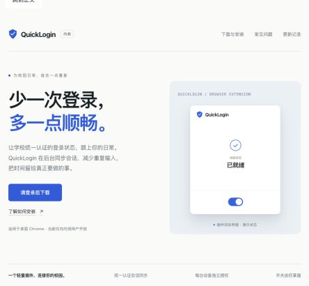

# QuickLogin 0.4.0 官网与受控下载：本地验收

日期：2026-09-28。状态：实现、独立复核和本地验收完成；首次云端初始化、推送、CI 运行与生产业务验收尚未执行。

## 交付

- 五页官网：主页、下载与安装、常见问题、隐私说明、更新记录。静态构建独立于扩展 dist。
- 下载入口仅有三个业务状态：请登录后下载、下载、内测中，暂未开放；无申请通道。加载和故障单独给出状态与重试。
- Auth 复用现有会话和资格规则，每次请求重新鉴权，从私有 R2 流式返回指定版本。
- 标签 vX.Y.Z 发布 ZIP；普通 main 合并不发布插件包。官网部署与插件发布、回滚工作流分开。
- 不做插件自动更新、更新助手、新版检查或商店上传。

## 本地证据

| 检查 | 结果 |
| --- | --- |
| 插件与官网测试 | 20 个测试文件，94 项通过 |
| Python 打包/发布测试 | 8 项通过；包含不可变对象、远端摘要失败、元数据缺失、CAS 冲突、版本比较和回滚 |
| Auth 单元测试 | 92 个文件，858 项通过 |
| Auth workerd 集成测试 | 30 个文件，317 项通过；复核后增强的 5 项下载测试再次通过 |
| 类型、API 与包门禁 | EXT、官网、Auth 两套类型及 API 生成一致性、lint、依赖边界、扩展 check:package 通过 |
| 网站 | 独立构建、6 个 HTML 入口及本地链接/资源检查通过 |
| CI 配置 | actionlint 1.7.7 通过；尚未在 GitHub 执行 |
| AWS CLI | 固定 1.42.49，真实 CLI 模型确认 IfMatch、IfNoneMatch 与 Metadata 参数；未执行生产 R2 写入 |
| Workers | 4.142.0 dry-run 通过；本地生产构建首页 200，未知页面 404，CSP 等安全头存在，演示 iframe 正常显示 |
| 浏览器 | 本地合成身份的三个状态符合预期；有资格链接绑定版本，无资格无 href；320px 窄屏首页与下载页均 clientWidth=scrollWidth=305，无横向溢出 |

测试过程中先看到缺失实现、CORS 401 丢头、版本信息刷新跳动、历史对象摘要元数据缺失和版本夹具无法区分字节等失败，再修复并验证。上游 SDK source map 警告和本地 DO alarm 时序提示未导致测试失败。

## 独立复核

由独立审阅者检查 EXT 与 Auth 的完整分支改动；未发现下载鉴权或发布完整性阻断缺陷。

- 320px 窄屏溢出：在浏览器复现后修复，首页及安装页读回均无溢出。
- 跨版本测试：vA/vB 现使用不同字节和 SHA-256；验证下载体摘要属于 vA，不属于 vB。
- 生产 R2 权限与条件写入、真实登录/二次验证/资格撤销、域名和 Worker 部署不在本地证据覆盖范围。

## 版本与包

- 官网及发布代码提交：`27f20484146a45f09238ebe055202e6ba05f670e`。
- Auth 提交：`08593b35159d4822904471131e6a477f4884c389`（分支 codex/quicklogin-website-downloads）。
- 本地扩展候选包源码提交：`c29f7ec84416bdce610d4c0e9b15fbbea14d7c42`。
- 包：`releases/cqu-quicklogin-0.4.0-canary.zip`，122318 字节，8 个文件。
- SHA-256：`c017d12fec904768b2bfc4e6a80fbb6fc034f9436e46bed9f0095f6d7151d474`。
- 协议：3，契约摘要 `0263d6f205e113cdc2da8661f2fdf8c7e5b52b5a41045b90633d8d5989625a38`。
- ZIP CRC、文件清单、内嵌 manifest 0.4.0、build-info 源码提交均已独立读回验证。
- 此包保留创建时的确切源码提交；后续开发工具与文档提交没有覆盖它。未来 CI 会按所推送标签重新生成自己的产物，不能把本地 SHA 当作尚未生成的 CI 包 SHA。
- 未创建或推送 v0.4.0 标签，未上传 R2，未部署 Auth Worker，无本次 deployed Worker version，未操作用户安装目录。

## 首次上线待办

只读预检确认 Cloudflare 账户 `User-Unauthorized` / `a666c560407022706a52a703923548d5` 可访问。目标桶 `cqu-quicklogin-releases` 尚不存在。私有仓库 `cqu-moe/quick-login` 没有列出 repository secrets 或 environments。

1. 核对目标域名和 Worker 是否有既有资源；本地 DNS 经代理解析，不能据此认定云端域名已配置或可覆盖。
2. 创建或核对私有 R2 桶，禁用 r2.dev 和公开域名；为 CI 创建仅限该桶的对象读写凭据。
3. 配置 quicklogin-release 环境的 R2_ACCESS_KEY_ID、R2_SECRET_ACCESS_KEY、CLOUDFLARE_ACCOUNT_ID 和 R2_BUCKET；配置 quicklogin-website 环境的最小 Cloudflare 部署凭据。现有 PostHog 构建配置可通过 POSTHOG_PROJECT_TOKEN 变量保留。
4. 先部署 Auth 接口，再推送已合入 main 的版本标签，读回 R2 和公开元数据及未登录拒绝，然后部署官网。
5. 使用明确授权的账号验收真实登录/二次验证返回、有资格下载及摘要，不为测试修改真实用户资格。
6. 将实际 Auth commit/Worker version、CI run、R2 版本与最终 SHA 更新到发布和交接记录。

## 实现取舍

- 沿用 Auth 的 Env 类型声明与资格来源，未为此任务重构类型生成或登录系统。
- 发布记录 schema 与公开字段校验放在同一服务模块，减少重复定义。
- 下载还验证 R2 对象大小和 sha256 自定义元数据；绕过发布脚本上传的缺失元数据包会被拒绝。
- 插件展示是实际渲染结果保存的无脚本 HTML，置于 sandbox iframe，并注明演示状态；Ego 截图超时后使用 IAB 做视觉检查。
- CI 将每次来源与摘要持久保存在 R2 记录并输出 job summary，仓库文档通过可审阅提交更新，避免自动改写 main 和 Git 身份。
- 官网工具升级至 Wrangler 4.142.0，因为 4.94.0 本地运行时不支持新的兼容日期；Auth 依赖未变。
- CLI 参数和合成存储测试不替代线上 R2 验收；未把工具能力当作账号已配置可用。

## 界面预览

以下为本地合成状态预览，不代表生产登录成功。

