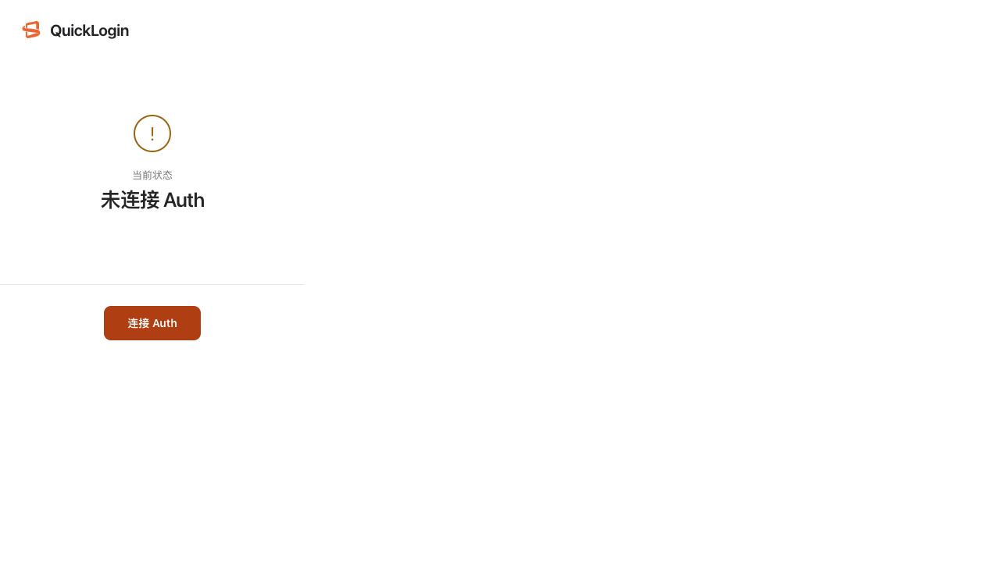

# ✗ tester-army rides a persistent Chromium context and loads the real MV3 extension

`e2e/capability.e2e.ts` · failed · 716ms

Ran on: browser `chromium 156.0.8078.4` · user agent `Mozilla/5.0 (Macintosh; Intel Mac OS X 10_15_7) AppleWebKit/537.36 (KHTML, like Gecko) HeadlessChrome/156.0.0.0 Safari/537.36`

**ASSERTION_FAILED**

```text
expected "forced-negative-control" to be "expected-failure"
```

Look at: `e2e/capability.e2e.ts:21`

## Steps

1. ✓ `app.open` `/` (82ms) — `e2e/capability.e2e.ts:6`
   - screen: 2 nodes at `/`
2. ✗ `browser.goto` `chrome-extension://igfidegfgfoofnoncpmbcokbffjmmook/popup.html` (0ms) — **POLICY_DENIED** — `e2e/capability.e2e.ts:10`
   - ↪ navigated to `chrome-extension://igfidegfgfoofnoncpmbcokbffjmmook/popup.html`
3. ✓ `expect.toBeVisible` `getByRole("button", name: "连接 Auth")` (37ms) — `e2e/capability.e2e.ts:18`

## Screen at failure

`chrome-extension://igfidegfgfoofnoncpmbcokbffjmmook/popup.html` · viewport 1280x720 · 7 nodes



The screen as the agent reads it, one node per line: `#id role "name" text="…" [states]`.

```text
#root document "CQU 快捷登录"
 #n3003 main
  #n3004 text="QuickLogin"
  #n3005 status "当前状态 未连接 Auth"
   #n3006 text="当前状态"
   #n3007 heading "未连接 Auth"
  #n3008 button "连接 Auth"
```

## Evidence

- [screenshot](attempt-1/screenshots/001-failure.png) `.e2e/negative-1792084888301/run/results/capability-tester-army-rides-a-persistent-f9665fe68c7a8dbc/attempt-1/screenshots/001-failure.png`
- [screen](attempt-1/screen-at-failure.txt) `.e2e/negative-1792084888301/run/results/capability-tester-army-rides-a-persistent-f9665fe68c7a8dbc/attempt-1/screen-at-failure.txt`

<sub>e2e 0.21.0 · run `01a14095-549d-7247-a2bc-8bd58201659e` · the whole run is in `report.json`</sub>
