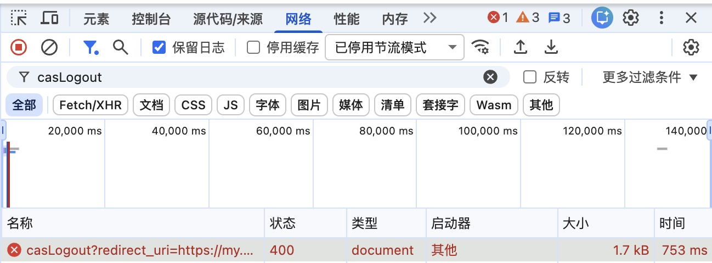

# Issue #47 学校登录恢复排障

来源：[Issue #47](https://github.com/cqu-moe/quick-login/issues/47)、[Jam](https://jam.dev/c/4e8c271c-3d77-4a65-b3db-65c0d3b765de)，2026-11-09 检查当前 Chrome。

## 证据与范围

- Jam 无麦克风录音，无法取得语音转写。约 28 秒扩展重新加载学校登录页后显示已就绪，约 52 秒再次访问业务页仍回到学校登录页。
- 网络记录为成功返回的学校登录 HTML，未捕获扩展后台 Auth 请求；控制台只有学校 Angular 的事件错误，没有 QuickLogin 堆栈。不能仅凭这些记录确定学校首次拒绝同步会话的原因。
- 当前 Chrome 运行 0.5.6；内容脚本已经识别登录页并生成失败提示，但提示位于学校第一个辅助表单的 `display:none` 父元素中，尺寸为零，用户看不到失败及重试操作。
- Auth 的 QuickLogin 登录代理将旧 `seedState` 传给云端浏览器，允许复用仍能取得服务票据的会话，这是既有测试明确规定的行为。无条件清除种子的候选会扩大到全部刷新，且不能解释首次拒绝，已撤回。
- 合成输入已复现一个独立合同缺口：TGC 在 SSO 域、SESSION/rg_objectid 在 `.cqu.edu.cn` 时，`hasValidTgt` 返回 true，但 `extractSsoCookies` 只导出 TGC。尚无真实 Cookie 属性证明本次失败命中此缺口。
- 本地 `setDetails` 保留协议中的域名/路径/Secure/HttpOnly/SameSite/到期时间；每项写入及整组结束均读回验证。这个验证不能发现导出之前已经漏掉的 Cookie。扩展没有打开学校页面就主动清理 Cookie 的路径；清理由撤销、停用、旧项清理和回滚触发。
- 学校公开脚本包含受配置控制的 `deviceID` 浏览器指纹重写，以及用户确认重新登录时执行 logout 的分支；源码存在分支不证明本次触发，需实际变化时序。Jam 未记录到 logout 请求，Cookie 头已脱敏，不能据此排除学校响应删除或覆盖 Cookie。

## 当前 Chrome 的第一轮脱敏观察

用户返回了 0.5.6 的 46 秒记录：22.785 秒导出 7 项，包含 TGC、SESSION、rg_objectid，全部属于 `sso.cqu.edu.cn`、路径 `/`，本次没有前述父域过滤。22.803–22.814 秒能观察到 4 个 Secure Cookie 写入；31.607 秒起 SESSION、JSESSIONID 和防护 Cookie 被覆盖，最终值与导出不一致，事件本身不能确定写入者。

第一版诊断脚本有权限盲区，不能将其报告的 TGC、rg_objectid、sidTheme 缺失解释为漏写：QuickLogin 只有 HTTPS host 权限，Chrome 的 `cookies.getAll`（包括带 HTTPS url）及 `onChanged` 不暴露非 Secure Cookie，但 `cookies.get({url,name})` 能读到它们。隔离 Chrome 使用真实扩展权限与合成 Cookie 已复现：两项均写入成功，列表/事件只显示 Secure 项，精确 get 读到另一项，实际 HTTPS 请求携带两项。

诊断脚本 v2 改为精确 get 补齐、每 500ms 观察非 Secure 项、导出后 250ms 自动逐项比对；真实 Chrome 自检确认非 Secure 项可见且报告不包含 Cookie 值。

## 当前 Chrome 的第二轮脱敏观察

用户提供的 v2 记录共 97 条，持续 42.476 秒：

- 7.410 秒 SESSION/JSESSIONID 被替换，7.600 秒观察到先前存在的 TGC 消失。
- 15.454 秒导出 7 项；15.811 秒的读回确认 7 项全部存在，值和属性全部与导出相同，包括非 Secure 的 TGC、rg_objectid、sidTheme。这次的域名、路径、字段转换、漏写可排除。
- 20.073 秒 SESSION/JSESSIONID 的值与属性被改写，20.097 秒观察到 TGC 消失；最终 rg_objectid 仍与导出完全一致，SESSION/JSESSIONID 及防护 Cookie 已不同。

实际失败位于成功写入后的学校访问阶段。观察数据证明 TGC 被移除，但没有直接记录 Set-Cookie 响应和写入者；结合扩展的清理调用点，学校拒绝会话是首要调查方向，尚未确定是过期、环境绑定或其他服务器校验。不能再以写入失败或父域过滤解释这次记录。

另有需核实的云端时效问题：QuickLogin 容器可复用种子 TGC，但 Broker 成功返回时仍设置 `loginAt = Date.now()`，设备可用期随之重新计算为七小时。这个源码行为不能单独证明本次 TGC 已过期，需与当前设备时间和实际会话验证证据对应。

## TGC 失效与设备绑定的区分

用户补充的状态时间（北京时间，2026-11-09）：`loginAt` 与 `lastValidatedAt` 均约 15:40，采样约 19:17，`usableUntil` 约 22:40；云端 `ready`、本地写入 `ready` 与 `schoolAccess=login_form_seen` 同时存在。`usableUntil` 来自 Auth 自己的七小时计算，不是学校返回的票据有效期；这份状态不能证明 19:17 时云端仍能用同一票据取得学校服务票据。

- Jam 的初始 `/login` 导航没有 `Device-Id` 请求头，随后 `/protected/api/aggregate/login_info/get` 请求存在该头。学校公开脚本会用语言、User-Agent、内存、CPU 并发数、时区、平台及 WebGL 信息计算指纹；`deviceID` Cookie 则由 `trusted.device.manager.enable` 控制。指纹请求头存在，不等于 TGC 校验实际启用了绑定。
- 本地浏览器为 macOS Chrome 156，云端容器源码固定 Linux Chrome 148，环境确实不同；学校是否据此拒绝本次票据尚无直接证据。
- [SourceID 厂商 FAQ](https://sourceid.ruishan.cc/linkid/authentication/faq/faq.html) 确认该产品使用 `SOURCEID_TGC`，但没有给出重庆大学的设备/IP 绑定配置。[上游 CAS 文档](https://github.com/apereo/cas/blob/master/docs/cas-server-documentation/authentication/Configuring-SSO-Cookie.md) 描述了 TGC 与 IP、User-Agent 的关联，只能说明存在这种机制，不能代替学校的实际配置。
- Jam 的学校配置响应为加密正文；匿名读取公开配置返回 HTTP 412，未继续处理防护挑战，尚未取得 `trusted.device.manager.enable` 的实际值。
- Auth 已有 `decodeJwtExp` 诊断函数，但 QuickLogin 的可用期计算未读取学校 TGC 的 `exp`。新增[一次性票据时间检查](issue-47-ticket-expiry.js)，仅观察现有导出的 TGC，在用户浏览器内解析并输出过期时间、剩余分钟数和云端时间，不输出票据或其他 claims。合成自检覆盖已过期、未过期、无效时间和不透明票据，并确认响应不变、监听恢复及秘密不出现在输出中。

待取得实际 `exp` 后再区分：早于失败时刻可支持票据已经过期；晚于失败时刻仍不能排除服务端提前撤销、闲置超时或环境绑定；无法解读时不作寿命结论。尚未更改学校指纹、User-Agent 或认证配置。

### 后续现场结果

- 用户返回的一次性时间报告：导出 200、TGC 存在，但 `expSeconds=null`。只能说明当前解析器读不到有效的数值 `exp`，不能推断无过期时间或已经过期。
- 同一次报告的云端 `loginAt=1794223951713`（19:32:31.713），采样 `now=1794223991361`（19:33:11.361），相隔 39.648 秒；用户确认此时仍回到学校登录页。`loginAt` 刷新并不证明 TGC 值已经更换：现有 `/run` 仍可凭旧种子取得 ST 后返回原会话。
- 用户补充：同一台 Mac 以前成功过，近期开始失败，其他用户也反馈不可用。这是多人近期回归的线索，尚无其他设备的独立日志，不能直接归因于学校或扩展升级。
- 远端 Auth `main` 已核对为 `f3a56022be1c3849191a695fa63313c8d3cb8ece`；19:46 左右读取生产 `/api/v1/cqu/quicklogin/capabilities` 的 `serverBuild` 与之相同。近期提交未修改学校登录/Cookie 路径。云端 Chrome 148 的固定版本并非本周新改动；学校后端策略仍需另行核实。
- Jam 中 `loginNew.js` 的 `Last-Modified` 为 11 月 5 日 15:46:15（北京时间），主 Angular bundle 为 10 月 14 日。前者已检查为布局、横竖屏及页面壳选择逻辑，没有 TGC/Cookie 清理代码；资源更新时间不能证明后端策略变更。
- 现场对照使用现有设备开关：等待关闭完成后重新开启。Auth 的设备禁用路径会清空该设备 `storageState`，再次开启从空种子登录。用户随后确认 QuickLogin 同步后已能直接进入教网，没有手动输入密码或扫码；但经常出现“正在保留已有学校登录”，点击切换看起来没有变化。这说明不能把故障概括为云端 Cookie 一律不能跨设备使用，仍未直接证明先前 TGC 被移除的具体原因。

## 可重复的弹窗问题

实际写入后，保持 TGC 不变、替换辅助 SESSION，再经真实 `sync` 路径检查，会保留一个 `result=foreign` 的回执；这是避免覆盖变化中的本地 Cookie 的保守处理，不能据此断言用户另行手动登录。现有说明却将其统一称作“非插件写入的学校登录”。

点击切换会保存有效的单次授权并启动后台同步，但弹窗仍优先显示旧 `foreign` 回执。在对账请求延迟时，测试稳定复现“操作已接受，仍显示保留已有学校登录和切换按钮”，与用户感知的无响应一致。

修复只调整展示：有效切换授权期间以等待同步的状态显示进度；辅助 Cookie 变化的提示明确“若仍能访问学校网站，无需重复切换”。Cookie 判定、精确摘要、单次授权、撤销边界及回滚不放宽，不把已变化的 Cookie 宣称为已精确验证。

## 修复

- 扩展将提示放在 `#normalLoginForm` 所属登录标签面板之前，同时覆盖扫码和密码模式。
- 修正切换进度被旧冲突回执覆盖，以及辅助 Cookie 变化被描述为另行登录的问题。
- Auth 暂无保留的补丁，等待实际写入/导航前后证据决定修复位置。
- 上述界面修复不增加依赖、权限或持久化状态；后续自动恢复修复在既有恢复轮次中增加阶段字段，见文末。

## 回归证据

- 在真实页面结构的测试夹具前添加隐藏辅助表单后，扫码与密码两项测试在旧代码下均因隐藏祖先失败；修改后通过，相关扩展回归共 47 项通过。
- 界面修复阶段 QuickLogin：271 项应用测试、扩展类型检查、构建、包/契约检查通过；此前 35 项发布工具测试、官网/E2E 类型检查、官网构建/检查及分片准入自检通过。
- 新增的切换分支直接复用实际 Cookie 写入/轮换回归：旧代码分别在提示文案和等待进度上失败；修改后通过，并验证等待期间 Cookie 不被提前覆盖、同步结束后回执完成且单次授权被消耗。
- 最终构建的隔离 Chromium 原生弹窗检查通过，浅深主题 390×468、服务进程启动正常，临时进程与 profile 均清理；报告 `.e2e/launcher-smoke-1794225810814/report.json`。该检查不等于真实账号的新版本验收。
- 隔离 Chromium 的内容脚本回归使用带隐藏辅助表单的页面：提示可见，真实鼠标、键盘及输入可操作，页面篡改动作和合成事件仍被拒绝。
- Auth 候选曾通过类型检查、1,039 项普通测试及 474 项 Durable Object 测试，但候选及测试修改现已全部撤回，不据此声称初次登录失败已修复。
- [临时诊断脚本](issue-47-cookie-observer.js) 用于用户在当前扩展 Service worker 控制台观察导出、Cookie 变化及逐项比对。不会写入 Cookie、读取令牌或上传数据，输出不包含 Cookie 值；v2 已在真实隔离 Chrome 验证权限盲区的补齐。

此阶段完整 MV3 E2E、远端 CI、部署及真实学校账号验收未执行；后续定向 E2E 尝试及阻塞见文末。本地构建包含未提交改动，构建元数据中的 HEAD 仅为基线，不能作为修复版本的正式来源证明。

修复尚未提交或部署，未在真实学校账号上复验新版本。用户已在旧版本上恢复自动登录；当前已排除观察期间的本地写入失败，但先前访问阶段移除 TGC 的具体原因仍未查明，不能声称整个 Issue 已根治。

已在原 Jam 留下一句限定范围的修复说明并读回确认（评论 `ec9a77a1-3a66-49c0-8ce6-b56f735fe938`），明确本地候选尚未发布且初始 TGC 消失原因未确认。

## 继续调查：教务网是否使统一认证会话失效

用户提出 `my.cqu.edu.cn` 可能是触发点，本轮仅补充证据，不修改认证行为。

- 重新检查 Jam 中全部 123 条 SSO/教务网请求：没有 `logout` 路径、`renew` 参数或 `Clear-Site-Data` 响应头，也没有 DBSC 会话头。三个 `/login` 请求的 `service` 均为 `https://my.cqu.edu.cn/authserver/authentication/cas`。Jam 的 Cookie/Set-Cookie 整字段被隐去，且没有记录这次链路中的中间 302，因此不能从它还原删除 TGC 的响应。
- 在匿名研究浏览器复走教务网入口，观察到 `/workspace` → `/authserver/casLogin?redirect_uri=…`（302）→ SSO `/login?service=…`（200 登录页），没有 `renew`；见[脱敏导航记录](issue-47-public-navigation.json)。另用不自动跟随重定向的 HTTP 请求检查 `/workspace` 和 `/authserver/casLogin`，均无 `Clear-Site-Data`，后者只设置 `redirect_uri` 和防护 Cookie。匿名路径不代表真实账号回调后的行为。
- 用匿名请求与合成无效 TGC 对照访问 `/login`（另覆盖 Jam 的 service）：均为 200 登录页，响应重建 SESSION/JSESSIONID 和防护 Cookie，未发送删除 TGC 的 Set-Cookie。这说明重建辅助 Cookie 本身不足以证明设备绑定；合成无效票据也不能代表学校签发后过期或撤销的真实票据。
- 教务网和云端确有共同入口：Auth `src/durable-objects/cqu-session.ts:122` 的 `DUMMY_SERVICE` 就是上述教务网 CAS 回调。容器 `container/cqu_login_cdp.py:156–165` 在本次导航捕获 ST 后即可返回；`ChromiumSession` 每次新建空的 tickets 列表，通过本次网络请求和重定向收集 ST。它不是直接读取旧缓存里的 ST，但也不等待教务网完成登录验收。Broker 随后更新 `loginAt`，并不证明颁发了新的 TGC。现有初始导航复用测试 2 项通过（`python3 -m pytest container/test_cdp_lifecycle.py -q -k 'initial_navigation_ticket_reuses_session_without_password_or_code or chromium_session_closes'`）；这些测试不验证学校生产策略。
- 普通 JavaScript/Set-Cookie 不能从 `my` 主机直接改写属于 `sso` 主机的 host-only、HttpOnly TGC；但 `Clear-Site-Data: "cookies"` 可以影响整个注册域及其子域，教务网也可能通过 SSO 登出或后台撤销间接使票据失效。前两条已在现有记录中检查，后台撤销仍无学校侧日志。依据：[Cookie 作用域](https://developer.mozilla.org/en-US/docs/Web/HTTP/Guides/Cookies)、[Clear-Site-Data](https://developer.mozilla.org/en-US/docs/Web/HTTP/Reference/Headers/Clear-Site-Data)。
- 上游 CAS 的 [DefaultCasCookieValueManager](https://github.com/apereo/cas/blob/6.6.x/core/cas-server-core-cookie-api/src/main/java/org/apereo/cas/web/support/mgmr/DefaultCasCookieValueManager.java) 确有可配置的 IP/User-Agent 校验；[InitialFlowSetupAction](https://github.com/apereo/cas/blob/6.6.x/support/cas-server-support-actions-core/src/main/java/org/apereo/cas/web/flow/login/InitialFlowSetupAction.java) 在取不到有效票据时清理 TGC。Cookie 解析/环境校验失败与服务端票据失效可能汇入相同后续处理，不能仅凭“Cookie 被删”区分它们，更不能把上游默认配置当作学校部署配置。
- 学校公开前端的 `trusted.device.manager` 控制 deviceID 指纹，和后端 CAS 的 TGC/IP/User-Agent 校验不是同一个配置。本轮匿名配置读取未获授权（401），未继续尝试；尚未取得实际开关。教务网应用脚本匿名访问重定向到登录页，未取得其已登录分支实现。

下一份有区分力的证据应是同一份导出、同一浏览器下的入口对照：先直接访问 SSO，再从教务网进入，关联第一次 TGC 消失与对应响应的 Cookie 名称/删除属性、Clear-Site-Data、重定向；保留票据比较结果但不输出值。如果 SSO 直接访问已失败，应降低教务网前端触发的优先级；若仅经过教务网回调后失效，则继续查其后台登出/会话策略。当前没有这组真实账号对照，仍不能判定教务网或设备绑定为根因。

本轮未新增生产补丁、未部署、未操作用户当前 Chrome 登录态；匿名研究页面已关闭。并行审查未取得独立源码结论，以上源码与测试结论均由主任务本地核对。

### 后续：当前 Chrome 的入口前后对照

用户授权在当前 Chrome 继续检查，并单独授权只读查看 `self.cqu.edu.cn` 的登录状态。只检查页面状态，不进入个人信息或安全设置，也不保存落地 URL 中的个人参数。

1. 直接打开 `https://sso.cqu.edu.cn/login`，落地 `https://self.cqu.edu.cn/cas-success/`，可见已登录的个人中心。
2. 同一研究标签访问 `https://my.cqu.edu.cn/`，落地 `/workspace/home`，可见工作台，没有登录表单或错误提示。
3. 再次直接访问 SSO `/login`，仍落地个人中心 `/cas-success/`，没有登录表单或错误提示。

访问教务网时浏览器工具一度报告扩展 UI 阻塞；用户回复未看到弹窗并允许继续后，重新读取页面确认已进入工作台，再完成第三步。没有点击登录、退出、切换或同步操作；未取得 Cookie 身份和后台请求时序，因此不能保证期间没有扩展自动恢复，也不能将这次页面对照声称为严格的同一 TGC 对照。

当前会话未复现“进入教务网后统一认证失效”。这排除了本次访问必然导致失效的说法，但不能排除故障时的条件性响应、后台撤销或会话过期，也不能反推此前 TGC 消失的具体原因。初始故障仍待捕获失败当次的 SSO/教务网响应、重定向和脱敏 Cookie 变化关联；没有足够证据新增认证补丁。0.5.7 展示修复仍为本地未发布候选。

### 教务网退出、OAuth2 与 CAS 的关联

用户随后明确要求退出教务网再重新登录，并指出其独立 OAuth2 会话。本轮在当前 Chrome 执行了以下对照：

1. 在已登录工作台的用户菜单点击“注销登录”。导航期间一度仍显示工作台，后续稳定落地 SSO 登录表单；不能把中间状态误记为退出失败或自动登录成功。
2. 直接访问不带 service 的 SSO `/login`，仍显示微信扫码/用户名密码登录，而不是个人中心。这次退出后的影响已经越过教务网自己的登录态；没有直接读取 TGC，不能声称测到了本轮 TGC 的删除响应。
3. QuickLogin 弹窗显示“快捷登录未成功”；点击“重试快捷登录”后显示恢复状态，随后显示保留已有学校登录。再点击“切换到快捷登录”并重新进入教务网，最终落地 `/workspace/home`，工作台可见、无登录表单，未输入密码或扫码。

浏览器可见历史的重新登录入口为 SSO `/login?service=https://my.cqu.edu.cn/authserver/authentication/cas`。该历史不是完整网络记录，不证明中间没有 OAuth2 请求。

从已恢复的工作台资产清单取得当前主脚本 [app.5c6b3ede.js](https://my.cqu.edu.cn/workspace/static/js/app.5c6b3ede.js)，以不携带浏览器 Cookie 的独立公开请求下载成功；SHA-256 为 `488ff434b7f9f3645373eb05f6214155810c229ecbc984d637733c3c4b239dbb`。没有导出用户令牌或存储。源码确认：

- 当前构建配置 `useCas="true"`，认证服务位于教务网自己的 `/authserver`。
- 登录先走 `/authserver/casLogin`；CAS 回到 `/workspace/cas` 后，路由调用 `authorizationRedirect()`，再经 `/authserver/oauth/authorize`、`/workspace/token-index` 和 `/authserver/oauth/token` 获取教务网自己的 access/refresh token。用户关于独立 OAuth2 会话的判断成立，CAS 与 OAuth2 串联而非互斥。
- 菜单“注销登录”调用 Vuex `Logout` → 登录模块 `logout`。该模块清理本地 OAuth 状态，若仍有 access token 则尝试 `/authserver/logout` 和 `/authserver/remove_token`，最后导航到 `/authserver/casLogout?redirect_uri=…`；即使前面的注销请求失败，`finally` 仍执行 CAS 退出导航。
- **无需主动点击退出也可能进入同一路径**：刷新函数 `S()` 调用 `x()` 请求 OAuth token；无论刷新被 HTTP 拒绝还是网络 Promise 失败，catch 都调用 `g()`（上述 logout）。刷新开始前会先移除 access token，失败后的 logout 通常可直接跳到 CAS 退出。API 401 分支会触发刷新；到期前十分钟的鼠标活动也可触发刷新。
- 另有明确入口 `cookies=clear`：路由清理教务网本地存储和可见 Cookie 后调用同一 logout；它不是每次打开网站都执行的无条件清理。

本地以[最小复现脚本](issue-47-my-refresh-repro.mjs)直接提取并执行这份已固定摘要的公开 bundle 中 `Lr` 登录模块，只提供合成令牌、内存状态和无网络请求桩：

```sh
node docs/research/issue-47-my-refresh-repro.mjs /tmp/quicklogin-47-public-js/app.5c6b3ede.js
```

断言通过：刷新 200 保留登录且不跳转；刷新 HTTP 401 或网络失败均清理本地认证并导航 `/authserver/casLogout`。这证明上述前端分支的真实实现，不代表在生产强制制造了网络失败或取得学校后端注销日志。

再次核对原 Jam 的 34 条教务网请求，没有捕获 `oauth/token`、logout、`remove_token`、CAS 认证回调或 `cookies=clear` 页面参数，也没有教务网请求错误。因此现在有了一个具体且可复现的“教务网 OAuth2 刷新失败 → CAS 退出”机制，可以解释没有手动退出仍影响统一认证的可能路径；但还不能断言原 Jam 就是这条路径，下一次故障应定向检查 token 刷新失败及紧随其后的 `casLogout`。不修改学校页面、不阻止用户主动退出、不绕过认证；本轮只补充研究脚本和记录。

### 自动恢复缺口与现场验证延期

用户要求模拟 OAuth2 刷新失败并修复自动恢复。已确认的扩展原因是：学校删除 TGC 后，QuickLogin 能补回云端缓存，但补回的票据再次被拒绝时会直接结束恢复，没有继续发出 `retry_session` 申请新会话。

- 新增回归经过真实后台消息、同步和 Cookie 写入调用链，旧实现对“再次删除 TGC”和“保留 TGC 但回到登录页”均发出零次重试请求，断言失败；另覆盖第二次拒绝前对账网络失败、多个等待标签分批返回、最后一次 Cookie 检查中用户切换手动登录。
- 修复在已有 `loginRecovery` 中保存 `restoring` / `refreshing` 阶段：最多补回缓存后再申请一次新会话，新会话仍被拒绝则停止导航，保留手动登录入口。旧版本缺省阶段继续按原来的有限恢复处理，不扩大重试次数。
- 多标签页升级到新会话恢复时一起重置等待页导航标记；队列里迟到的旧表单通知不能在已补回缓存后提前请求新会话。操作前校验本地代际和恢复轮次，手动输入或停用不会被旧操作覆盖；外来 Cookie 保护、写入后精确验证与 ACK 后导航仍保留。
- Auth `f3a56022be1c3849191a695fa63313c8d3cb8ece` 的 `retry_session` 确实启动学校登录任务；云端种子若无法取得 ST，会进入已有密码/验证流程。未修改 Auth，也未无条件丢弃仍有效的云端种子；这依赖于实际被撤销的 TGC 不再获得 ST，不能代替学校现场验证。
- 最终本地 276 项应用测试、扩展与 E2E 类型检查、构建、包/契约检查和 `git diff --check` 通过。公开 bundle 的原刷新函数再次在无网络隔离执行中通过成功、401、网络失败三项断言。

新增定向 MV3 E2E 使用真实扩展、Auth Worker、DO、云端浏览器与合成学校响应，计划验证服务端撤销及两次删除旧 TGC 后自动获取新会话。此次运行固定 Auth `f3a5602`，在合成账号注册阶段返回 503，未进入恢复断言；当前消费方运行器未配置新 Auth 所需的 Turnstile 测试绑定。报告为失败，不能计为通过：`.e2e/issue47-revoked-ticket-1/report.json`、`runtime.json`。清理记录显示容器、代理和测试镜像均已移除，但由于账号准备失败、没有实际创建学校代理，严格的 removed-proxy 证据检查也失败；未放宽检查。后续需使用仓库 CI 固定的 Auth 依赖完成此测试，当前 Auth 兼容测试另行补齐。

现场脚本已备好：[单次刷新故障注入](issue-47-my-refresh-fault.js)仅在教务网页面拦截一次 OAuth token 请求并触发本地网络错误，由学校原有 catch 决定退出，不直接删除 TGC；[观察脚本 v3](issue-47-cookie-observer.js)记录 TGC 是否存在、是否与故障前相同以及恢复阶段，值只在内存比较，不输出或上传。两段脚本均已通过合成自检，尚未在真实学校故障链路执行。

用户报告教务网停机维护，现场验证延期至 **2026-11-10 08:30（Asia/Shanghai）之后**；本轮已停止访问教务网。待恢复后先用旧版取得故障注入和 TGC 变化证据，再加载候选复走同一路径。当前只确认前端刷新失败会调用 CAS 退出，以及扩展自动恢复的独立缺口；尚未证明真实学校在这次故障中撤销了同步 TGC，也未证明原 Jam 一定由这条路径触发。补丁未提交、未发布，不能将单元测试或合成学校行为当作真实账号验收。

### 2026-11-10 恢复检查与完整回归

- 08:42 后读取用户当前 Chrome 的教务网标签，`/workspace/home` 为已登录工作台；只取登录状态，未进入个人业务页面。当前 DOM 仍引用 `app.5c6b3ede.js`，未因此假定文件内容或服务端逻辑一定未变。已交回现场故障脚本，等待用户返回 v3 脱敏观察结果。
- 重用历史 CI 依赖目录的首次尝试在启动前失败：`node_modules` 指向已移除的其他工作树；报告 `.e2e/issue47-revoked-ticket-2` 保留，清理通过。随后在本票 `.worktrees/auth-e2e-issue47` 创建干净的 CI 固定 Auth `41147c934c577f6a10f5bf3d9cb71597c362a07f` checkout，按锁文件安装根/前端依赖并构建前端，未改 Auth 源码或测试门禁。
- 08:45:46 启动定向 MV3 回归，55.48 秒通过：合成学校使旧会话失效并至少两次通过 HTTP 响应删除旧 TGC，扩展补回缓存后自动发起一次真实学校密码/邮件验证流程，拿到新会话并导航到业务页；没有点击手动重试或直接注入扩展成功状态。
- `.e2e/issue47-revoked-ticket-3/report.json`：发现 25 项，选择/执行/通过 1 项，失败、跳过、中断、flaky 均为 0；本次不是完整 25 项套件。`runtime.json` 记录清理通过，2 个业务容器、2 个代理和独占 fixture 镜像均移除，profile 清理通过。
- 本次构建 `background.js` SHA-256 为 `8ebbb660e96530f63eab5ca697221c3e466c6a3d50f5bb06ff68a5f7f8208f9f`，`sourceDirty=true`；HEAD `20bba76d323871c439237d66bf77d5e6b0ab579b` 只是基线，不能用作候选修复的正式提交证明。该结果验证 CI 固定依赖中的真实调用链，不代表最新生产 Auth 的浏览器兼容检查，也不能证明重庆大学本次确实撤销了 TGC。

### 维护后首份 v3 现场记录：触发证据缺失

用户返回 0.5.6 的观察脚本 v3 报告，共 8 条记录：24ms 开始快照与 300124ms 自动停止快照中的 TGC 均存在、与开始值相同，7 项 Cookie 属性也相同；没有 `export` 或 `cookie-change` 记录。628ms 的三条非 Secure 项只是首次采样填充观察集合，不能算作实际新写入。176321–180505ms 的三条扩展状态均为云端/本地 `ready`、sessionVersion 31、schoolAccess `unverified`，未记录恢复轮次或错误。

这次没有观察到 TGC 删除或重新导出，也没有证明 OAuth2 故障注入确实触发；Cookie 值不变本身不能证明服务端票据仍有效。浏览器工具未取得故障注入日志，后续页面读取超时，未据此推断页面最终状态。用户表示已刷新页面、忘记第二段脚本输出，愿意重新执行；已要求开启 Console 保留日志，并先保留 `issue47-refresh-fault` 的成功或错误输出，再关联扩展观察结果。此报告不用于确认或否定 OAuth2 刷新失败与真实 TGC 失效的因果关系。

### 后续现场：调试暂停后进入空白 CAS 退出页

用户重试时提供截图：DevTools 停在动态混淆脚本 `VM427` 的 `debugger` 语句，页面显示“在调试程序中暂停”；故障注入脚本本身没有 `debugger`。暂停会阻塞该页面的后续 JavaScript 执行，不能用暂停期间没有跳转或 Cookie 变化来判定正常执行的结果。尚未查明混淆脚本的实际来源，不将其归因于 QuickLogin 或特定防护厂商。

用户随后报告页面进入 `https://my.cqu.edu.cn/authserver/casLogout?redirect_uri=https://my.cqu.edu.cn/workspace/cas` 并停住。浏览器工具独立读回同一地址，DOM `readyState=complete`，没有可见文字或登录表单，截图为白页；限定错误日志查询未返回记录。此时页面 DOM 可被读取，当前停滞不能继续笼统解释为先前的调试暂停。没有取得这条请求的状态码、重定向响应或对应 TGC 时序，不能把白页称作退出成功或服务端撤销已确认。

QuickLogin 的内容脚本只注入 `sso.cqu.edu.cn`，学校页面恢复由 SSO 登录表单上报触发；停留在 `my.cqu.edu.cn/authserver/casLogout` 不会触发这条页面恢复入口。未因此扩大扩展权限或添加教务网页面自动跳转。已请用户保留本轮现场、返回现有观察 JSON 与 Network 中该请求的状态，不再重复注入；拿到 Cookie 时序后再决定如何恢复页面和复验候选。

用户随后返回本轮 v3 / 0.5.6 报告：19ms 开始、300119ms 结束，8 项 Cookie 的开始/结束属性相同，TGC 始终采样为存在且与基线相同；没有 `export`、`cookie-change`、采样错误或恢复阶段记录。81224–85576ms 的三条状态仍为 sessionVersion 31、云端/本地 `ready`、schoolAccess `unverified`。628ms 的三条非 Secure 记录仍只是首次采样。这与上一份 24–300124ms 报告是不同观察轮次，不能合并时序。

这份记录按五分钟上限自动结束；尚不知道调试暂停解除、进入退出页是否发生在这五分钟内，因此连“退出页执行期间没有删除 TGC”也不能据此确定。即使时间覆盖完整，本地 Cookie 不变也不能排除服务端撤销，500ms 采样亦不能排除间隔内短暂删除再写回。当前只确认观察窗口内未捕获删除或恢复。

再次读回退出页仍为 `readyState=complete` 的白页；没有捕获 `issue47-refresh-fault` 日志。尝试在独立标签进入 SSO `/login` 核对实际认证结果时，Chrome 报告其他扩展界面阻止自动化，未取得登录状态，未改用其他方式绕过。已请求补充现有 `casLogout` Network 状态码和跳转是否落在五分钟窗口内，不要求重新注入。候选自动恢复修复的本地通过结果不变，本轮不增加学校域名权限或新的退出页干预逻辑。

### 接手现场：退出地址返回 400，SSO 对照落地登录页

用户无法处理 `debugger`，明确要求由代理接手。通过 Chrome 原生 DevTools 界面检查：退出页当时显示“未暂停”，Network 没有保留原始请求。临时停用断点捕获、开启保留日志，重新加载**同一个现有退出地址**，请求行返回 **400 Bad Request**，耗时 753ms，传输 1.7kB、资源大小 0B，页面保持空白；这是代理重新请求的结果，不补作先前故障注入请求的状态码。



随后在独立标签直接访问 `https://sso.cqu.edu.cn/login`，最终落在 `/login?`，DOM 加载完成，密码输入框与 `normalLoginForm` 均存在，没有进入已登录个人中心。该页 0.5.6 插件横幅 DOM 显示“快捷登录未成功，请在学校页面手动登录，或重试快捷登录”，但横幅没有可见矩形，复核到此前已修复的隐藏提示问题；没有点击手动重试或输入账号密码。

因此本轮白屏的直接故障已定位为退出接口返回 400，而非仍在调试暂停；当前统一认证也未直接接受浏览器会话。未取得学校服务端拒绝原因、该轮 Cookie 时序或成功登录的紧邻基线，仍不能将 TGC 失效归因于这次 400、原先 OAuth2 刷新失败或设备绑定。未改写学校页面或增加扩展权限。已恢复断点启用状态、Network 原有保留日志开关和过滤器，并关闭此次打开的 DevTools；只保存裁剪后的状态码证据，不保留请求头、Cookie 值或其他标签内容。
