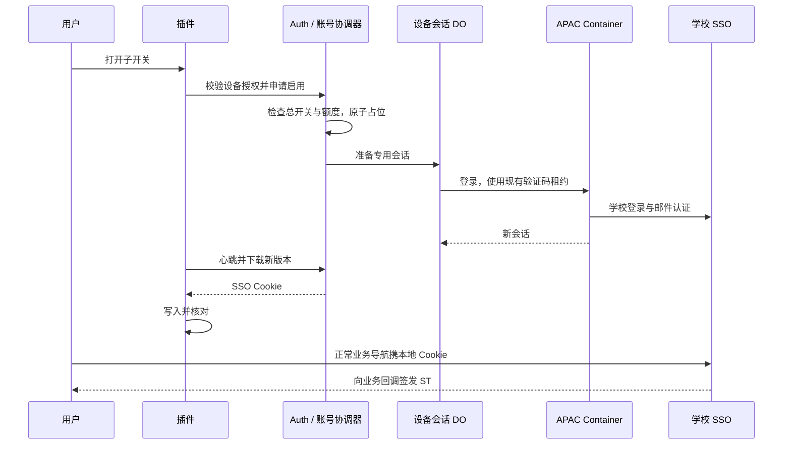

# CQU Quicklogin 浏览器插件设计

日期：2026-09-09。状态：已汇总用户确认内容，供最终审阅。本文描述目标设计，正式产品尚未实现。

## 1. 已确认的产品行为

- 用户已登录 CQU Auth、已绑定学校账号且网页总开关开启时，打开插件子开关即自动准备并同步 Cookie，无单独激活、文件下载或手动导入步骤。
- 每个插件安装实例拥有独立 SSO 会话；管理员设设备额度，网页管理总开关、设备列表和强制退登。
- 正常登录使用本地 SSO Cookie，由浏览器直接与学校交互，无需每次经过 Auth。
- 服务端后台维护专用 SSO 会话；插件后台检查版本并同步更新，不要求打开插件面板。
- 首版 Chrome Manifest V3。正式商店发布后由 Chrome 分发程序更新；开发者加载的实验目录不作为自动升级渠道。
- ST 不预取、不缓存；需要访问具体业务时才由学校生成并立即回调。

## 2. 实验结论及其边界

Cloudflare APAC 的生产 CquLoginContainer 类创建了独立实验实例，成功新登录并导出 8 个 SSO 专属域 Cookie。本机 HTTP 客户端关闭环境代理，仅使用这些 Cookie，请求学校 SSO 得到 302 和新 ST，耗时 345 ms。

随后门户回调后的页面返回 412。因此此次结果证明 Cloudflare 来源的 Cookie 可被本机请求用于出票，未证明完整 Chrome 业务登录、所有网络兼容、长时间保活或多设备并发。未采集两端实际公网 IP 数值。原腾讯云实验不作为此结论的依据。临时 Cloudflare Worker、令牌及本轮 Cookie 导出已删除。

2026-09-09 21:43 补充：五会话短测通过。Cloudflare 串行建立 5 份会话，SOURCEID_TGC 去重数为 5；全部建立后，本机 5 个新 HTTP Session 分别携对应 Cookie 请求 SSO，5/5 返回 302 且向预期门户签发新 ST，耗时 312–884 ms，未观察到新登录挤掉前面的会话。临时 Worker 和令牌已删除。详见 `docs/five-session-verification.md`。仍不代表五个实体设备/出口 IP、长期保活或完整业务浏览器登录验收。

## 3. 选定架构

选用「设备专用会话 + 服务端后台维护 + 本地 Cookie 同步」。对比方案：每次由 Auth 取 ST 会增加每次登录往返；纯失效后补发会把重登等待暴露在用户打开业务时。二者不作为首版用户可选模式。

设备指插件安装实例，同一 Chrome 资料中的标签页共享它。每个用户的每个安装实例有独立 quicklogin 会话记录，与课表采集会话分开。独立是相对其他服务端会话；复制到本地后，服务器和该设备仍共享同一份学校会话，不具有独立撤销语义。

Auth 负责用户身份、资格和学校凭据；设备会话 Durable Object 负责状态、版本与定时维护；APAC Container 负责登录和探测；扩展负责本地开关、后台同步、Cookie 写入与登录页恢复。学校密码只在现有 Auth 后端链路处理，不下发扩展。

验证码申请与消费必须接入现有按账号协调的验证码租约。不得为设备会话复制一套互不协调的发码逻辑。容器任务使用现有 bootId 检查与截止时间；并发登录合并，同一设备只允许一个在途恢复。

### 模块和数据归属

| 模块 | 职责与权威数据 |
| --- | --- |
| Auth 身份服务 | 用户身份、OAuth 授权与设备 grant 关联 |
| 账号设备协调器 | 每用户唯一串行入口；设备额度、总开关、子开关、名额和撤销状态 |
| 设备会话 DO | storageState、loginAt、lastKeepAlive、sessionVersion、generation 和定时维护 |
| 现有验证码协调链 | 按学校账号串行申请验证码、分配租约与路由邮件 |
| APAC Container | 请求期间执行登录与探测，不作为长期会话权威存储 |
| 插件后台 | 本安装的设备凭据、已应用版本、Cookie 管理摘要和手动模式 |
| Auth 设置页与插件弹窗 | 展示服务端状态、提交操作，不另存一份额度真相 |

管理员、网页和插件的名额/开关写入均通过账号设备协调器，数据库中的管理字段作为经协调器确认后的读模型。跨 DO 不假设事务：账号侧先落授权状态和 generation，再幂等通知设备 DO；设备 DO 开始维护、提交结果和导出前重新核对权威授权，通知延迟不能恢复已撤销权限。

设备记录包括 deviceId、ownerUserId、grantId、deviceName、browserFamily、browserVersion、enabled、enabledAt、lastSeenAt、lastIp、revokedAt、generation。sessionVersion 表示 Cookie 内容版本，generation 表示启停/授权生命周期，两者不混用。仅记录最近 IP，不新增 IP 历史追踪。

## 4. 设备额度、层级开关和设备列表

管理员配置允许的设备数量，替代 `cqu.quicklogin_access` 布尔资格。额度为非负整数，0 表示不能使用。网页 `cqu.quicklogin` 是账号总开关，插件子开关仅控制当前安装实例；总开关关闭时不允许插件绕过开启。

额度按已启用且未撤销的设备占用，在线状态单独显示，不用心跳短暂断开释放名额。正常离线、休眠仍保留名额；关闭子开关或强制退登释放名额。关闭总开关暂停所有设备，保留子开关和名额，重新打开后自动恢复。页面使用「已启用 2 / 5 台」，避免把名额等同于实时在线数。

开启子开关时，按账号串行/事务检查额度并占位，然后准备会话；并发请求不能超额。准备中、恢复中占名额。临时失败保留用户开启意图；需要处理时也保留名额，用户可关闭或移除。设备上线不重新注册，重试注册和启用都必须幂等。

管理员降低额度时，按最近联系时间保留额度内的已启用设备，其余设备关闭子开关、停止保活和 Cookie 下发，释放名额。此规则已由用户确认，具体行为如下：

- 对已启用且未撤销设备按 lastSeenAt 降序排列，保留前 N 台；无联系时间排最后，时间相同则按 enabledAt 降序、deviceId 字典序升序稳定排序。最近联系来自有效插件请求，不把服务器保活时间当成用户最近使用。
- 超额设备保留在列表，显示「设备额度已减少，已停用」。保留插件登录授权，不执行强制退登；仅关闭快捷登录。其心跳和状态查询继续可用，但不能恢复维护或领取 Cookie。
- 用户可关闭一台仍启用的设备，再开启自己想使用的设备；开启操作重新原子检查名额。后续额度增加不自动重启被停用设备。
- 额度为 0 时关闭全部设备子开关；总开关设置保留，不因额度恢复自动重新开启子开关。
- 管理员保存前预览将保留和停用的设备。预览附额度/设备状态修订号；若期间心跳、开关或列表改变导致停用名单变化，保存不按旧名单静默执行，而是返回最新预览供重新确认。真正保存由账号协调器串行完成额度更新、停用名单和 generation 递增，再幂等通知设备会话 DO。
- 停用不删除业务系统 Cookie、不调用学校全局退出。在线插件下次状态检查时停止本地同步并清理仍可确认归属的 SSO Cookie；已登录学校页面可能继续保持登录。

额度校验和调整由同一个账号协调器串行执行，不依赖扩展自觉上报。现有布尔权限的迁移需管理员给出具体设备额度，不自动将 true 推断为 5 台；切换前预览迁移映射，避免误清原用户资格。

### 用户操作

- 未登录：显示「登录 CQU Auth」。必要的账号登录不称为激活。
- 未绑定学校账号：进入现有绑定页，插件不重复收学校密码。
- 总开关开启且有空余名额：打开插件子开关，自动准备、写入 Cookie。
- 总开关关闭：插件显示「请先在 Auth 开启快捷登录」，提供进入设置页的入口。
- 展示状态：已关闭、正在准备、已启用、正在恢复、需要处理。准备完成以本地写入并核对为准。

关闭本机子开关立即停止本地同步、自动登录和该设备云端维护，清理仍匹配插件管理记录的 SSO Cookie。不删除业务 Cookie，不调用学校全局登出；学校自行轮换且无法确认归属的条目保留。全局关闭立即停止服务端维护和下发，在线扩展在下次状态检查时暂停；其子开关意图不被清除。

### 设备列表和心跳

Auth 设置页显示：设备名称、浏览器类型及版本、当前设备标记、子开关状态、在线状态、最近联系时间、最近来源 IP，以及「退出此设备」操作。在线判定为最近 10 分钟收到有效心跳，超过显示离线；文案说明「在线状态根据最近联系时间估计」。展开最近联系时间可看到完整时间。

复用插件每 5 分钟状态请求作心跳。IP 由服务端可信请求上下文取得，不信任客户端提交的 IP/任意转发头，表示最近访问 Auth 的出口地址，不推断精确位置。设备名、浏览器类型和版本由插件报告，按不可信显示文本校验和转义，不作为认证依据。网页列表只对账号本人及既有合法管理权限可见，不在列表展示学校 Cookie。

### 强制退登

网页允许用户退出指定设备：服务端原子标记撤销、增加 generation、释放名额、停止维护、废弃本设备保存的 SSO 状态，并撤销本设备的插件授权/刷新凭据。每次请求实时检查该设备撤销状态，不能仅等待 JWT 过期。其他设备和网页 Auth 登录不受影响。

撤销的设备 grant 不能利用仍存活的旧令牌自动重新注册；再次使用需要新的交互式插件授权。在线插件收到明确 DEVICE_REVOKED 后清理本设备令牌和可确认归属的 SSO Cookie，显示已退出。临时网络错误不能被当成撤销。离线设备重新连接后同样执行清理。

页面在设备列表下方常驻一句简短说明，退出确认时复用：

> 退出后将停止此设备的快捷登录；已登录的学校系统可能仍保持登录。

不承诺立即作废已经下发的学校 Cookie，也不为实现这个按钮调用学校全局注销。

## 5. 后台维护与同步

云端复用现有 Auth 会话维护策略，以下 1 小时保活、7 小时主动重登周期已由用户确认；它们是运行策略，不是学校有效期保证：

- 服务端每 1 小时保活一次启用设备的 SSO 会话，复用现有 KEEPALIVE_INTERVAL_MS。使用后端定时唤醒，不常驻 Container。
- 从最近一次成功登录的 loginAt 起计算，会话年龄达到 7 小时时主动强制重登，即使保活仍成功也执行；复用现有 PROACTIVE_RELOGIN_MS 与判定逻辑。成功后更新 loginAt、保存新 Cookie 并递增版本。保活或插件同步不能重置 loginAt；调度延迟和失败按现有逻辑处理，不承诺精确到秒。
- 返回 alive：保存探测后的状态；导出 Cookie 实际变化才递增版本。
- 返回 expired：触发一次协调后的重登，成功后递增版本。
- 返回 unreachable：保留现有会话，不误判失效。从第一次瞬时失败开始计时：前 5 分钟每 1 分钟重试，5–30 分钟每 3 分钟，30 分钟–2 小时每 5 分钟；之后按 10、20、30 分钟退避并封顶 30 分钟。任意一次成功或进入 needs_reauth 都清零失败窗口。
- 密码拒绝、账号解绑或需人工认证：停止自动重登，标记需要处理。
- 扩展每 5 分钟检查状态版本；打开开关、浏览器启动和重新联网时补检查。正常情况下新版本才下载 Cookie，不重复覆盖同版本的本地轮换结果。插件管理的 Cookie 被删除且没有外来会话时，允许在单轮恢复中显式重新应用同版本；不能覆盖外来 TGC 或越过手动模式。
- 插件同步同时更新设备 lastSeen；连续 7 天无联系暂停该设备的云端维护，但保留子开关和名额；下次在线且总开关、子开关仍启用时恢复。用户可在列表退出长期不用的设备释放名额。

### 本地登录状态判定与失败提示

SSO 状态分为「可用」「需要登录」「暂时无法判断」。访问学校 `/login?service=...`，若重定向到本次预期的业务回调且带新 ST，说明学校接受本次 SSO 会话；单独出现 302 或仅存在 SOURCEID_TGC 均不能证明登录。是否完成业务登录由业务系统校验 ST 后的实际页面决定。

插件正常使用不额外发探测取票请求、不截获或消费正常导航的 ST：有效 Cookie 的情况下浏览器自然完成学校跳转，插件无需介入。仅当 SSO 登录表单真实出现并可交互、当前尚未完成本轮 Cookie 同步且未处于手动模式时，启动一次同步恢复；成功写入后仍出现表单则直接提示。表单识别核对 SSO 域名、预期登录路径和账号密码表单特征，不凭地址含 login 或 HTTP 200 判定。

云端保活结果只说明云端会话状态；下载和写入成功分别表示传输与浏览器写入结果，不显示为「学校已登录」。网络错误、412/风控页、验证码挑战和未知页面为暂时无法判断，不一律触发账号重登。

失败处理按阶段区分，不能把技术重试和学校要求登录合并：

- 下载失败：网络超时、连接错误和服务端暂时错误允许最多重试 2 次，间隔 1 秒、3 秒；429 遵循 Retry-After 并计入预算，未到时间不发请求。401/403、设备撤销和明确需人工处理不作为网络故障重试。
- 写入失败：可恢复的 Cookies API 失败或回读不一致，最多重试 2 次，间隔 1 秒、3 秒。重试前重新检查开关、generation、版本和当前 Cookie；不得重放旧版本覆盖更新状态。权限未授予、数据校验不通过、会话过期等确定性失败直接提示。未完成本轮全部写入和核对不能标记版本已应用。
- 下载、写入成功后，只导航原登录地址一次。若学校 SSO 仍明确显示登录表单，本轮快捷登录判定失败，直接提示用户手动登录；不再自动重新下载、重登或刷新页面。此判定只说明当前本地登录失败，不据此宣称云端所有会话失效。
- 多个标签页共享恢复和重试预算，页面刷新不能无条件重置预算。技术重试用尽后同样保留学校原页面，提示「手动登录」或由用户主动重试。

首次尚未同步 Cookie 时看见登录表单可以触发一次正常同步；「写入成功后仍要求登录」才适用上述直接提示规则。

| 失败阶段 | 用户提示 | 行为 |
| --- | --- | --- |
| Auth 会话下载/连接失败 | 正在重试连接…；次数用尽后：暂时无法连接快捷登录服务，可先手动登录。 | 按下载预算重试，保留已有本地 Cookie |
| Cookie 写入失败 | 正在重试写入…；次数用尽后：登录信息未能写入浏览器，可先手动登录。 | 按写入预算重试，不标记未完成版本已应用；保护并发变化 |
| Cookie 写入成功后学校仍要求登录 | 快捷登录未成功，请在学校页面手动登录。 | 直接提示，不自动重试、不再触发云端重登或页面跳转 |
| Auth 访问令牌过期 | 正常自动续期；失败后提示：请重新登录 CQU Auth。 | 合并一次续期并最多重放原请求一次 |
| 设备撤销 | 此设备已退出快捷登录。 | 不续期或重新注册；手动学校登录仍可用 |
| 学校网络/风控异常 | 学校页面暂时无法完成登录，请稍后重试。 | 保留学校提示；不声称密码错误或会话已失效 |

选择手动登录后，对该设备设置持久化的自动恢复暂停标记；后台心跳仍正常，云端会话仍按开关维护，但暂停本地 Cookie 覆盖和自动跳转，避免打断用户输入、验证码或覆盖其手动登录会话。插件显示「已切换手动登录」，用户主动「恢复快捷登录」或重新开启子开关后才恢复本地自动同步；不自动清除手动登录会话。提示使用简短内联状态，不弹出反复出现的模态框。学校密码和人工验证码仅在学校原页面输入。

浏览器退出、电脑休眠、后台调度延迟不保证准点同步。浏览器恢复时重新确保定时任务存在并补检查。服务端定时维护不依赖浏览器在线。

## 6. 扩展身份与 API 边界

扩展通过 Auth 已有 OAuth 能力进行授权码加 PKCE 登录。注册扩展专用客户端及固定回调；不在扩展内存放 client secret。令牌限制给本功能，不复用其他客户端授权。每次插件安装授权绑定唯一设备 grant，刷新令牌与该 grant 关联；仅 userId 加可任意填写的 deviceId 不能作为设备隔离。设备 grant 不放入 Chrome 同步存储。全局同意开关和网页设备管理接受 Auth 网站 Better Auth session；插件 scope 仅可管理自身子开关、心跳和 SSO 同步，无权修改总开关或操作其他设备。

对外接口放在 `/api/cqu/quicklogin/devices`，与现有 `/api/cqu/quicklogin` 的 session-only 全局开关路由独立挂载：

| 操作 | 接口 | 行为 |
| --- | --- | --- |
| 本机注册 | POST /devices | 服务端生成设备 ID，绑定当前认证用户；注册幂等 |
| 本机开关 | PUT /devices/:id | 事务校验名额后更新设备 enabled；打开自动准备，关闭释放名额并取消维护 |
| 网页设备列表 | GET /devices | 网站会话认证；列出本用户设备、额度和最后联系状态 |
| 网页强制退登 | DELETE /devices/:id | 网站会话认证；撤销设备 grant、停止维护、释放名额 |
| 状态/心跳 | POST /devices/:id/status | 返回状态、版本、最近成功时间；更新 lastSeen，无 Cookie |
| 恢复 | POST /devices/:id/refresh | 合并在途任务，返回准备中或可用版本 |
| 导出 | POST /devices/:id/export | 仅导出当前版本的 SSO 白名单 Cookie |

网页操作从 Better Auth session 取 userId；插件操作从经过签名、有效期、issuer、audience 校验的令牌取 sub 和客户端身份，不接受请求体指定 ownerUserId。插件注册为官方 public client，采用 PKCE S256、state 和固定回调，新增专用 `cqu:quicklogin:device` scope；不能用 `cqu:ticket:any` 代替 SSO Cookie 导出权限。一个安装授权只允许幂等注册同一设备，旧 grant 不能无限注册新设备。网页写操作继续执行现有来源和 CSRF 校验。

| 请求类别 | 开关与额度检查 |
| --- | --- |
| 网页读取总开关、额度、设备列表或退出本人设备 | 有效网站会话及对象归属；总开关关、额度为 0 时仍可管理 |
| 插件注册、心跳、关闭子开关 | 有效官方设备授权；注册不占名额，额度满时仍可查状态或关闭 |
| 插件开启子开关 | 总开关开、额度大于 0，原子分配名额；重复开启不重复占位 |
| 恢复、导出及后台维护 | 设备授权有效、总开关开、子开关开且拥有有效名额 |

所有插件接口实时核对 grant 归属及撤销状态，不能仅相信 JWT 中旧权限。错误包括 UNAUTHORIZED、NO_DEVICE_CAPACITY、DEVICE_LIMIT_REACHED、DEVICE_REVOKED、MASTER_DISABLED、DEVICE_DISABLED、PREPARING、NEEDS_REAUTH、TEMPORARY_UNAVAILABLE。关闭或额度不足不能阻断状态查看与退出。

导出响应包含 protocolVersion、deviceId、generation、sessionVersion、createdAt、cookies，设置 no-store；仅允许登记的扩展 Origin，不开放通配跨域。设备状态响应区分云端 ready 和插件最后回报的 appliedVersion，不声称云端 ready 就是本地已写入。现有全局开关接口返回设备额度替代 eligible 布尔值；设备路由不能被父级 session-only 中间件误拦。

访问令牌过期时，grant 仍有效才合并一次刷新令牌操作并重放原请求一次；续期失败提示登录。设备撤销直接停止访问，不尝试重新注册。具体适配现有 OAuth 客户端注册和 scope 实现列入实施阶段，不创建通用远程调用或任意 URL 代理。

## 7. Cookie 写入和竞态

首版只导出 `sso.cqu.edu.cn` 与 `.sso.cqu.edu.cn` 专属域 Cookie，排除其他业务域与 localStorage，保留 path、secure、httpOnly、sameSite 和有效期。必须存在非空 SOURCEID_TGC；不会使用 JSON 文件导出年龄代替学校有效期。

Chrome 用 Cookies API 写入，不直接改加密 Cookie 数据库。声明 cookies、storage、alarms、identity 和 Auth/SSO 必要站点权限；登录页检测限于 SSO。不开全站访问权限，不向业务网站注入脚本。

同设备同步串行化；服务端任务携带 generation 防止关闭后迟到结果重新启用，版本单调递增；扩展关闭时递增本地 generation，写入前后检查同一 generation。写入失败不更新已应用版本；记录部分写入，撤回仍匹配本轮值的新增或覆盖条目，不能误删并发变化。

若本地存在非插件管理的 SOURCEID_TGC，暂停自动覆盖，显示「已有学校登录，继续使用当前会话」，仅用户主动选择切换后替换。首版普通 Chrome 资料支持，无痕不启用，避免默认 Cookie 存储区混用。

Cookie 值只存在必要会话存储与短期操作内存，不写日志、同步存储、分析上报或公开导出。插件持久化版本、设备标识和用于识别已管理条目的摘要；不得仅凭 Cookie 名字判定它属于插件。

## 8. 程序更新

正式版本经 Chrome Web Store 发布，交给浏览器下载和安装；不从后端下载可执行脚本。后台会话同步与程序升级分别处理。扩展升级后恢复开关、设备标识与后台定时，不重新注册设备、不重复新建学校会话。服务端接口保留协议版本；不兼容时显示需要更新，不能破坏当前 Cookie。

## 9. 实施验收

| 触发 | 状态及行为 |
| --- | --- |
| 开启成功 | preparing，占位并准备会话；重复请求复用任务 |
| 本地写入核对完成 | ready，记录 appliedVersion；不代表所有业务已登录 |
| 总开关关闭 | paused，保留子开关和名额，停止维护与导出 |
| 子开关关闭 | disabled，释放名额并取消工作 |
| 云端过期或满 7 小时 | refreshing，重登成功后保存新版本 |
| 已写入仍显示学校登录表单 | needs_manual，直接提示，不自动重登 |
| 用户选择手动登录 | manualOverride，暂停本地覆盖和跳转，保留心跳 |
| 设备授权被撤销 | revoked，释放名额，旧请求结果不能恢复权限 |

云端会话状态、用户子开关和本地 manualOverride 分开存储。关闭或撤销先持久化 generation，再取消待处理任务；无法取消的容器请求，其迟到结果也不得提交。

- 打开开关触发准备和同步；关闭时即使旧请求晚到也不能重新写入。
- Chrome 完整登录学校门户，排除已有业务 Cookie 干扰；记录本地成功页面，不以写入成功或 ST 单独替代。
- 每小时保活、loginAt 满 7 小时强制重登、保活不重置 loginAt、expired 提前重登、unreachable 保留、验证码自动接收均有状态机测试。
- 验证与课表采集争用验证码时的租约串行性；设备会话不覆盖课表状态。
- 五会话短测已通过，证据见 docs/five-session-verification.md：5 份不同 TGC 全部建立后 5/5 可出票。长期、多设备出口和完整业务登录仍按各自验收项处理。
- 验证下载/写入暂时失败最多各重试 2 次，确定性错误不重试；Cookie 写入成功后学校仍要求登录时直接提示，不触发额外下载、重登或导航。选择手动登录后定时同步不得覆盖用户手动会话。
- 验证名额并发申请不会超额；总开关暂停但保留子开关；子开关关闭/退登释放名额。额度 5→3 时按最近联系保留 3 台，稳定处理时间相同和无心跳设备；超额设备停用但不撤销授权；额度增加不自动重启；预览名单发生变化时重新确认。
- 验证强制退出只撤销目标设备，旧 grant 不能重新注册，离线恢复后清理，网络故障不被当作撤销。
- 扩展重启/升级、后台唤醒、版本变化、写入失败与撤销权限路径通过针对性测试。
- 内测记录真实调度与轮换行为，验证与现有 1 小时保活、7 小时重登策略一致。公开发布前通过完整浏览器验收；当前一次实验不是公开发布验收。

## 10. UI 设计与实现约束

**用户明确指定：UI 设计以 `emil-ask-emil` 为入口，设计、实现和交付前必须应用 `emil-unslop-design`。两项均为必需要求。**

- UI 设计入口：`/Users/uu/.codex/skills/emil-ask-emil/SKILL.md`。开始网页面板、插件弹窗、设备列表或退出确认的 UI 任务时，先按该 skill 判断当前阶段，选取最相关的一至两个设计 skill，逐项执行，不一次堆叠加载全部。
- 本项目是设置和设备管理界面：布局阶段优先由入口路由到 `emil-design-foundations`；开关、表单和状态交互阶段路由到 `emil-forms-and-inputs`。后续按实际问题路由，不为已确认的设计另做多套原型。
- `emil-unslop-design` 贯穿上述 UI 工作，负责删掉无用装饰、建立符合本产品的视觉选择，并在交付前再次检查。

Skill 路径：`/Users/uu/.codex/skills/emil-unslop-design/SKILL.md`。后续实施计划每个 UI 任务都必须显式引用 `emil-ask-emil` 和 `emil-unslop-design` 两项要求，不只在最终润色时使用。

- 继承 Auth 现有配色、组件和字体；采用清晰的设置页结构，左侧设备信息、右侧开关和操作。桌面用设备列表/表格，小屏按信息优先级换行，保持可读。
- 网页以总开关、已启用名额、真实设备列表为核心；插件以当前设备子开关和实际状态为核心，不做营销首页、功能三卡、装饰统计或大标题 hero。
- 不使用无依据的紫蓝渐变、玻璃背景、发光装饰、emoji 图标或无意义入场动画。图标复用现有同一套图标，颜色用于表达可操作性和实际状态。
- 以当前设备标记、清晰时间、可辨认的浏览器信息体现这个产品的用途；无设备时显示真实空状态，不虚构在线人数或成功率。
- 执行 skill 的删减检查：每个说明、徽章、边框和图标都须帮助识别状态或完成操作。保留简短退出范围说明，去掉重复标题、重复 CTA 和无实际信息的描述。
- 交付前执行 skill 的最终视觉检查，并验证键盘操作、开关标签、错误/禁用/准备中状态与文字对比度。

## 11. 工作边界

正式实现涉及 quicklogin 新项目和现有 auth 仓库。当前 quicklogin 目录尚无 Git 仓库，本稿仅保存文件，未提交。实验目录保留为实验材料，不直接包装成正式插件。本文审阅通过后再编写具体文件、接口和测试对应的实施计划。
