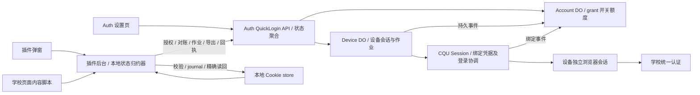
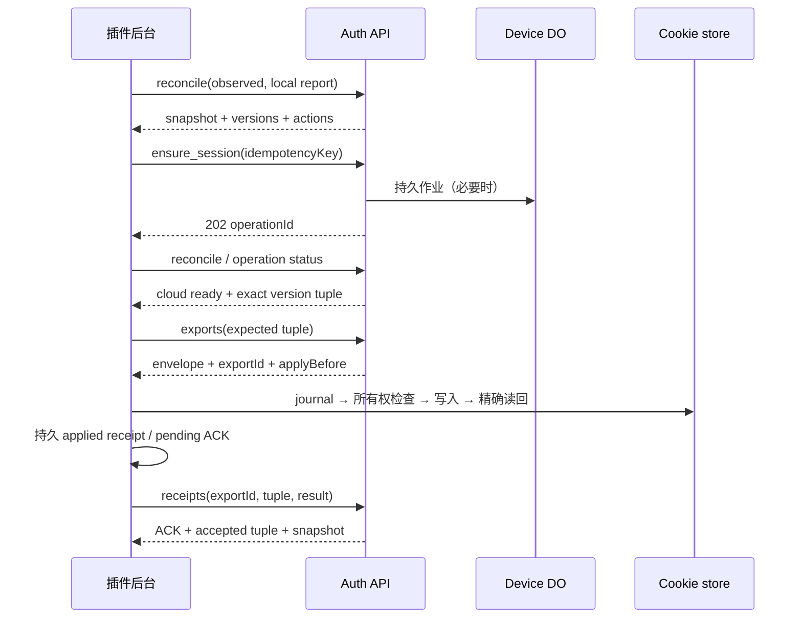

# QuickLogin 0.2.0：Auth 登录、设备会话与浏览器同步协议

日期：2026-09-15。状态：0.2.0 已实现并通过自动化与独立审查；实际发布、安装包和浏览器验收记录见 docs/operations/quicklogin-release.md。

## 1. 决策与目标

采用“统一控制与状态契约，每台安装实例保留独立学校会话”的方案。Auth 管理授权、学校绑定、登录作业和恢复；插件只管理本地意图、浏览器 Cookie、写入回执和页面交互。Auth 设置页、插件弹窗、学校页面提示使用同一组状态语义及动作定义。

目标不是让分布式系统永远不失败，而是让每次失败都具备明确的对象、原因、时间、恢复责任和下一步：可以自动恢复的由系统恢复，必须用户处理的只给出正确操作。不能再把“没查到”“正在换会话”“密码被拒绝”“插件授权过期”统称为“需要重新绑定”。

具体交付标准：

1. 同一设备、同一快照版本在 Auth 和插件中得到相同的云端状态；本地差异注明“浏览器刚更新，等待上报”或“最后上报于…”。
2. “已就绪”同时需要当前授权、有效的设备学校会话、当前版本的 Cookie 精确读回；在线心跳和 Auth 主会话都不能代替这些证据。
3. 暂时失联不会触发重新绑定；恢复网络后自动重新对账。真实撤销不能被重试恢复。
4. 重绑、更新密码、开关变化、部署、浏览器重启、并发请求和乱序回包都有确定迁移规则。
5. 发布前用两台设备和 Auth 主会话完成同一批端到端场景，分别记录服务端、插件和实际学校页面结果。

## 2. 调查基线和证据范围

本次已刷新两仓库远端引用：

| 对象 | 实际观察 |
| --- | --- |
| QuickLogin 主分支及 origin/main | `57f1d0f612d1c7f35895246301d6dd0e6ef2ebe2`，源码版本 0.1.3、协议 v1 |
| 最新本地修复分支 | `codex/quicklogin-stale-generation`，`7db7957`，源码版本 0.1.4、协议 v2 |
| 主目录 dist/manifest.json | 0.1.4；与主目录源码版本不同 |
| Auth 主分支及 origin/main | `204e0c32d56d61fae8011e924235747c7d7860b1`，含 v2 及后续登录恢复改动 |
| 本设计工作树 | `quicklogin/.worktrees/protocol-020-design`，从 0.1.4 分支建立 |
| 本次验证 | 现有插件 14 文件 / 47 测试通过、typecheck 通过；新增调查测试 5/5 按预期失败 |

调查开始时没有读取实际 Chrome 插件的实时 storage、生产错误链或当前 Worker 部署版本。后续只读核实了隔离 Ego 中的 0.1.4 也停在 needs_reauth，同时 Auth 主会话 active；未操作用户 Chrome。截图能确认两个界面呈现矛盾体验，不能确定截图中设备的精确服务端错误，也不能用磁盘 dist 版本证明 Chrome 已加载该版本。下文严格区分源码事实、合成复现和待生产验收项。

### 2.1 已核实的问题

| 编号 | 事实与后果 | 证据 |
| --- | --- | --- |
| F1 | Auth “正常”取自主会话 active；设备列表“在线”取最近联系时间。两处都未证明这台插件已应用 Cookie | Auth `frontend/src/pages/Settings.tsx:367`、`components/quicklogin/DeviceList.tsx:53` |
| F2 | 设备登录的 `needs_reauth` 原因未持久化、未输出；插件统一显示“需要重新绑定 / 学校账号状态已变化” | Auth `cqu-quicklogin-device.ts:443`；EXT `popup/view-model.ts:65` |
| F3 | 设备进入 `needs_reauth` 后删除闹钟；status 只对 paused 做恢复。插件 SYNC 不调用已存在的 refresh API | Auth Device DO、routes status handler；EXT `background/sync.ts:107`；调查测试 R3 |
| F4 | status 抛出 TypeError 等网络异常时，插件直接返回，不记录失联、不更新旧状态。旧的成功或重绑提示可以持续保留 | EXT `background/sync.ts:70`；R1、R4 |
| F5 | 插件采用新的 generation 后，仍仅以 appliedVersion == sessionVersion 跳过 Cookie 同步；没有应用回执所对应的 generation | EXT `background/sync.ts:90`、`:109`；R2 |
| F6 | 获取绑定状态的内部 HTTP 响应失败，被转换成 `{bound:false, epoch:0}`；查询失败与确实未绑定无法区分 | Auth `services/quicklogin/login-broker-client.ts:25`；R5 |
| F7 | status 从 Account/Device 分次读取并拼装，没有声明快照一致性；export 路由预检 sessionVersion 后，设备导出过程未携带客户端期望的 sessionVersion 做最终比较 | Auth `routes/cqu-quicklogin-devices.ts` 的 statusFor/export；源码风险，未复现生产竞争 |
| F8 | 两端契约独立维护；Auth `PROTOCOL_VERSION` 常量仍为 1，而 Heartbeat/Status 类型及 HTTP parser 已为 2。扩展 status 校验器只在测试中使用，API 成功响应直接类型断言 | Auth `services/quicklogin/contracts.ts`；EXT `background/api.ts`、`shared/validation.ts` |
| F9 | Device DO 将 Broker 的 temporary_unavailable 全部送入自己的退避，未保留具体原因与 retryAfterMs；两层重试没有统一可见时间 | Auth `cqu-quicklogin-device.ts` performLoginOnce/recordTransient |
| F10 | 弹窗打开时读取一次缓存，未订阅后台状态变化，也不主动对账；交互完成后的再次 render 不是持续同步 | EXT `popup/main.ts`、`background/messages.ts` |

F2 的已知源路径包括：未绑定、明确 PASSWORD_REJECTED；类型还允许 interactive_required。不能由主会话 active 推导保存的密码仍正确：旧主会话可能无需重新验证密码。正确设计应允许“已有会话仍有效，但续期需要更新密码”，并且两端一致说明这个事实。

另外，Auth 当前会把主会话 storageState 作为设备登录 seedState，Container 会导入 seed Cookie。独立的 Device DO/容器路径本身不能证明学校 TGC 独立。0.2.0 必须验证种子数据和会话隔离，不能仅凭注释认定隔离已成立。

调查复现见 [研究记录](../../research/2026-09-15-protocol-020/README.md)。以上不是本次截图的生产根因结论。

## 3. 方案选择

| 方案 | 收益 | 代价 / 限制 | 决策 |
| --- | --- | --- | --- |
| 在 v2 上继续补错误分支 | 改动少 | 状态含义、回执、版本管理和恢复责任仍分散 | 不作为完整方案 |
| 统一状态契约、作业协调、应用回执，独立设备会话 | 可以逐步迁移，修复状态不一致并保留撤销/隔离能力 | 需要双方及设置页配套，补充跨层测试 | 推荐，0.2.0 目标 |
| 把 Auth 主会话 Cookie 直接共享给所有设备 | 表面上更易复用主会话 | 一台设备可能影响全部会话，凭据暴露范围变大，撤销语义弱化 | 不采用 |

不重写现有 OAuth、额度 Account DO、Cookie 所有权机制和已经引入的登录锁恢复工作流。扩展这些边界的输入、输出和幂等性；避免再引入一套平行登录协调器。

## 4. 组件职责与唯一事实来源



| 对象 | 唯一写入方 | 其他组件如何使用 |
| --- | --- | --- |
| Auth 网站会话 | 现有 Auth 登录系统 | 只用于网站操作/用户授权，不代表扩展已连接 |
| 扩展 grant、撤销、总/子开关、设备额度 | QuickLogin Account DO | 所有敏感操作实时鉴权；D1 仅投影，不决定权限 |
| 学校绑定、凭据版本、账号身份、可信凭据错误 | CQU Session DO / 登录协调模块 | 以结构化 BindingSnapshot 查询；失败必须返回 unknown/unavailable |
| Auth 主学校会话 | 现有 CQU Session DO | 独立显示“Auth 服务端会话”，不冒充设备学校会话 |
| 设备学校会话、登录/保活作业 | 每设备 Device DO | 通过版本化快照和导出接口使用 |
| 本地启用/手动意图、Cookie 写入日志及读回结果 | 插件 service worker | popup/content script 只能发送有限命令、读取安全状态 |
| 设备最近上报 | Account DO 中的版本化投影 | Auth 标注“设备上报”及时间，不能当成实时读本地浏览器 |
| 总体 UI 状态 | 共用的纯函数和状态表 | 不直接由各 UI 自行拼接服务端字符串 |

## 5. 状态模型：事实与界面状态分开

### 5.1 分层事实

| 层 | 状态 | 说明 |
| --- | --- | --- |
| authorization | disconnected / authorizing / authorized / refreshing_token / reconnect_required / revoked | 是否有合法插件 grant；deviceId 不等于授权有效 |
| policy | enabled / master_off / device_off / quota_blocked / service_paused | 用户意图和服务运行条件。总开关关闭保留设备启用意图 |
| binding | unbound / updating / bound / unknown | unknown 包含查询失败；绝不转换成 unbound |
| credentials | unknown / verified / rejected / interaction_required | 与已有会话是否还能用分别记录；附当前版本、失败阶段、证据时间 |
| cloudSession | absent / queued / logging_in / ready / refreshing / retry_wait / blocked / expired / paused / revoked | Device DO 的独立学校会话生命周期 |
| localSession | unknown / missing / applying / applied / foreign / manual / permission_denied / write_failed | 本地 Cookie 状态；cloud ready 不自动等于 applied |
| observation | fresh / checking / stale / unreachable | 最近一次与 Auth 的通信结果与快照新鲜度 |
| schoolAccess | unverified / accepted / login_form_seen | 当前已知页面结果，不扫描所有学校业务；accepted 需要实际业务验收证据 |

### 5.2 对外 UI 状态表

按优先级归约；同一输入只产生一个主标题、一个主动作，必要的次要事实可用一行说明。按用户后续反馈，设备行最终仅展示名称、单一状态及一行版本/联系信息；重复的云端/本地解释删除，退出后果只在确认时展示。机器字段不放进普通用户界面。

| 条件 | 主标题 | 主动作 / 自动行为 |
| --- | --- | --- |
| 本地明确停用或正在退出 | 已关闭 / 正在退出 | 本地立即停止写 Cookie，后台补交服务器命令 |
| 已确认 grant 撤销 | 此设备已退出 | 连接 Auth；自动重试不得复活旧授权 |
| 无授权 / 授权确已失效 | 未连接 Auth / 需要重新连接 Auth | 用户触发 OAuth；不要求重绑学校账号 |
| 协议或本地结构不支持 | 请更新插件 / 服务正在升级 | 查看升级说明；停止业务写入，保留设备身份 |
| 总开关关闭 | 快捷登录已暂停 | 前往 Auth 开启；展示开关原因 |
| 子开关关闭 / 配额停用 | 此设备已关闭 / 设备名额已满 | 开启 / 管理设备 |
| 用户手动模式 | 手动登录中 | 恢复快捷登录；状态查询可以继续但不写 Cookie |
| 本地发现其他会话 | 已有学校登录 | 明确选择“切换到快捷登录”；不自动覆盖 |
| 对账超时 / 失败 / 缓存超期 | 暂时无法连接 Auth / 正在检查 | 自动重试；说明上次同步时间，旧错误仅作为历史 |
| 绑定权威确认 unbound | 尚未绑定学校账号 | 去绑定；只有这一项使用“绑定”主动作 |
| 绑定 updating 或版本变化 | 正在更新学校登录 | 等待绑定完成并重建设备会话 |
| 无可用会话且当前凭据明确 rejected | 学校密码需要更新 | 去更新密码；不误导重绑邮箱 |
| 无可用会话且明确需要交互验证 | 需要完成学校验证 | 到指定验证流程，显示具体验证码/验证类型 |
| 作业 queued/logging_in/refreshing | 正在准备学校登录 / 正在更新登录 | 展示阶段与等待说明；保持“关闭”可用 |
| 云端 retry_wait | 学校登录暂时不可用 | 显示服务端允许的下次尝试时间，允许受限“重试” |
| 云端 ready、本地未应用 | 正在同步到浏览器 | 下载、写入、精确读回、回执 |
| Cookie 权限不足 / 写入失败 | 浏览器权限不足 / 浏览器同步失败 | 修复权限 / 重试本地写入；不触发重绑 |
| 当前 Cookie 已应用、回执未收到 ACK | 浏览器已同步，正在确认 | 只重传回执，不重复写 Cookie 或重新登录 |
| 会话仍有效，但凭据 rejected 或续期暂时失败 | 当前可用，续期需处理 / 当前可用，正在重试续期 | 展示具体处理动作；不把旧会话证明当成密码正确 |
| 权限允许、观测新鲜、云端会话可用、对应 Cookie 读回成功且 ACK 成功 | 已就绪 | 可关闭；详细信息中保留最近检查/同步时间 |
| 缺字段 / 未知状态组合 | 状态暂时无法确认 | 对账或升级；不得默认显示 ready 或重绑 |

“已就绪”表示插件的 SSO 准备证据成立，不能声称所有学校业务永远可访问。若学校再次出现登录表单，立刻撤销当前本地 ready 结论并进入有次数限制的恢复。

Auth 设置页将“会话状态”改为准确的“Auth 服务端会话”。每台设备展示同一套快捷登录主状态，最近联系只作为次要字段。例如：`当前插件 · 正在恢复学校登录`，下面注明`最近联系… · 插件 0.2.0`，而不是用绿色“在线”代替就绪。

## 6. 标识、版本与并发栅栏

不得再把所有变化挤进一个版本号。保留现有 generation/sessionVersion 语义并补足缺失的范围。

| 字段 | 变化条件 | 校验规则 |
| --- | --- | --- |
| installationId | 每个安装实例生成一次，更新/重载保留 | 非秘密关联提示，不是授权凭据，不用 UA/IP 自动合并设备 |
| deviceId / grantId | 注册身份 / OAuth 授权 | 每次校验 user/client/scope/grant/device；跨设备请求拒绝 |
| generation | 设备开关、总开关、撤销、现有绑定失效广播 | status 允许旧观察值；操作严格匹配 |
| bindingEpoch | 账号解绑、重绑、身份或已提交凭据变化 | 只代表已提交配置，进行中的更改用 bindingTransitionId 表达 |
| credentialRevision | 已提交学校密码/验证配置变化 | rejected 只对其对应版本有效，不能污染后续版本 |
| sessionVersion | 设备 Cookie 内容有变化或新会话提交 | 单调递增；删除会话不回退复用旧号 |
| accountRevision | Account 状态、权限及上报变化 | Account DO 生成；用于列表一致性和配置命令前置条件 |
| deviceRevision / bindingRevision | 各自对象事实变化 | 各自对象生成，不能跨对象比较数值大小 |
| authGeneration | 退出或替换 OAuth 授权 | 独立于 Cookie 取消；手动模式/开关变化不能丢弃已轮换的 refresh token |
| localGeneration | 本地关闭、退出、手动接管、换设备、采用失效版本 | 每个异步写入前后检查；旧任务不能覆盖新意图 |
| clientReportSeq | 本安装当前授权下的持久上报序列 | 服务端忽略乱序及重复上报；换授权需新的 reportEpoch |
| operationId / idempotencyKey | 一次命令和一次云端作业 | 防止超时、刷新和闹钟重放导致重复登录或发码 |

应用回执必须绑定完整元组：`(deviceId, generation, bindingEpoch, credentialRevision, sessionVersion)`。旧版 appliedVersion 是无 generation 的历史信息，升级后不得直接作为当前成功证据。

任何 generation/bindingEpoch 改变都先令当前 receipt 失效、增加 localGeneration 并停止旧写入，再重新获取快照。即便 sessionVersion 数值相同，也必须重新验证并获取新回执。版本冲突不是账号失败。

### 6.1 跨 DO 快照一致性

不能把多个 DO 的顺序读取描述为原子事务。状态聚合器执行有界的“读取—组合—复核”：

1. 读取 Account 授权及 BindingSnapshot 的 revision/epoch；读取 DeviceSnapshot 和本地报告。
2. 再读控制状态，若权限/绑定版本变动，最多重新组合一次；仍不稳定返回 `RECONCILING`，不能拼出 ready。
3. DeviceSnapshot 的 generation/epoch 必须对应控制状态；未赶上广播时返回 syncing 并投递幂等 reconcile 事件。
4. 返回 snapshotId、各层版本向量、serverTime、observedAt/freshUntil。D1 的落后投影不能盖过这些事实。
5. 客户端只有一个对账调度器；请求附本地 seq。回包必须同时满足 identity、localGeneration、请求 seq 和同一 epoch 下的各分量不回退。不可按不同 DO 的 revision 大小作简单排序。
6. 错过广播可以由每次 reconcile 补偿。广播加快收敛，授权和导出不能依赖广播一定成功。

快照是一个一致的观察结果，并不授权未来写入。敏感操作及导出仍需独立实时检查。

## 7. 协议 v3：请求、响应与边界

扩展产品版本为 **0.2.0**，API 仍位于 `/api/v1`，QuickLogin 消息协议为 **3**，本地存储结构可升级到 **2**。四者含义不同，不能互相替代。

为使 0.2.0 是可兼容升级，采用新增 v3 路由，保留 v2 原请求/响应形状。不能在 v2 严格校验对象上直接添加字段。如果最终选择删除旧协议或不可回退的存储替换，则不再是本文的兼容发布，应按仓库规则重新定级。

以下路由是待实现设计，不代表当前已经可调用。

| 路由（公共前缀 `/api/v1/cqu/quicklogin`） | 身份 | 职责 |
| --- | --- | --- |
| GET `/capabilities` | 无凭据，允许固定插件 Origin | 只返回公开协议范围、功能能力、minExtensionVersion、服务构建版本 |
| POST `/registrations` | OAuth device grant | v3 注册/恢复；持久 registrationId 幂等，返回已有或新 deviceId |
| POST `/devices/:id/reconcile` | 对应 device grant | 心跳、采纳观察、可选回执重传、读取统一状态；旧 observed 版本不报错 |
| POST `/devices/:id/operations` | 对应 device grant | ensure_session / retry_session / set_enabled；快速返回 202 + operation + snapshot |
| GET `/devices/:id/operations/:operationId` | 对应 device grant | 查看作业，不能越权查看别的设备 |
| POST `/devices/:id/exports` | 对应 device grant | 严格版本检查，导出短期 Cookie envelope 和 exportId |
| POST `/devices/:id/receipts` | 对应 device grant | 上报 applied / foreign / permission_denied / write_failed / missing / manual，返回 ACK |
| GET `/overview` | Auth 网站 session | 统一的绑定摘要与设备视图；新端点避免改变旧列表契约 |
| PUT 总开关、DELETE 设备 | 现有网站 session + Origin 边界 | 复用现有路径/授权；更新后从 overview 读回；命令幂等与 revision 校验配套 |

### 7.1 通用封装

成功：`{ data, meta: { protocolVersion:3, requestId, serverTime, serverBuild } }`。

失败沿用 Auth API v1 problem 格式，统一包含 `type,title,status,detail,code,requestId,retryAt,action`。不再混用 `{error}`、`{detail:{error}}` 和裸字符串。v2 兼容适配器继续输出原结构。

所有业务响应 `Cache-Control: no-store`；Cookie envelope 大小保留现有严格上限，其他 JSON 上限 64 KiB；Cookie 响应禁止进入普通缓存、遥测和调试下载。Origin、Cookie 域名和消息发送者使用固定白名单。

### 7.2 reconcile 请求示例

```json
{
  "protocolVersion": 3,
  "requestId": "request-example",
  "client": {
    "extensionVersion": "0.2.0",
    "buildId": "extension-commit",
    "browserVersion": "152.0.0.0",
    "installationId": "installation-example"
  },
  "observed": {
    "generation": 4,
    "bindingEpoch": 3,
    "credentialRevision": 2,
    "sessionVersion": 7,
    "deviceRevision": 18
  },
  "reportEpoch": "report-epoch-example",
  "clientReportSeq": 12,
  "local": {
    "enabledIntent": true,
    "mode": "automatic",
    "cookieState": "applied",
    "receipt": {
      "exportId": "export-example",
      "generation": 4,
      "bindingEpoch": 3,
      "credentialRevision": 2,
      "sessionVersion": 7,
      "verifiedAt": 1789459200000
    }
  }
}
```

observed 可以为 null。reported enabledIntent 只是客户端观察，不改变服务端开关；更改必须通过命令并经过额度验证。上报时间是客户端声称的时间，服务端同时记录 receivedAt，不用客户端时间决定授权。

### 7.3 统一 DeviceSnapshot 必需字段

| 分组 | 字段 |
| --- | --- |
| identity | deviceId、installationId（仅同用户可见） |
| versions | generation、bindingEpoch、credentialRevision、accountRevision、deviceRevision、bindingRevision、sessionVersion |
| authorization | grant 状态、policy 状态、disabledReason、masterEnabled、deviceEnabled、deviceLimit、used |
| binding | state、credentialsState、evidenceAt、evidenceKind（first_factor_success/password_rejected/session_reuse/none） |
| cloud | state、operationId、stage、loginAt、lastValidatedAt、usableUntil、retryAt、reasonCode |
| reportedLocal | reportEpoch、clientReportSeq、cookieState、receipt 元组、receivedAt、verificationAge |
| presentation | statusCode、reasonCode、actionCode、actionTarget（固定相对路由）、nextCheckAt、freshUntil |
| capabilities | canEnsure、canRetry、canExport、canEnable、canUseExistingSession |

所有可缺失事实使用显式 null 或 unknown；不得用 epoch=0/unbound/ready 充当网络故障的默认值。未知可选字段可忽略，未知关键状态/版本停止写入并要求重新对账或更新。共享 schema 在网络边界运行，不能只写 TypeScript 类型。

## 8. OAuth、注册与设备身份

保留 Authorization Code + PKCE S256、state 校验、固定 callback、固定 clientId、resource/audience、device scope、独立 grant 与设备绑定。Token 只存 TRUSTED_CONTEXTS；popup/content script 不取得 token、Cookie 值、学校密码或验证码。

流程：

1. 安装生成 installationId、注册幂等键；有旧 deviceId/grant 的升级优先恢复，不重新申请名额。
2. 用户点击连接后先尝试已有授权。临时刷新失败保留身份并显示连接故障，不能自动制造新 grant。
3. Access token 401 仅进行一次有并发合并的刷新；明确 invalid_grant / revoked 才进入重新连接。403 必须按 code 处理，不统称 token 过期。
4. OAuth 回调严格比较 origin/path 及 state，不能只做字符串前缀判断；成功 token 兑换后，再完成幂等设备注册。
5. 浏览器中断恢复使用持久授权事务记录。旋转 refresh token 后收到响应但本地持久化前崩溃，是需要显式处理的恢复边界，不能假定 token 永远能重用。
6. 旧 grant 能证明设备归属时注册返回原 deviceId。installationId、浏览器名、IP 都不单独构成此证明。
7. 若旧 grant 已失效，新的 OAuth 同意页提供“重新连接此设备”的明确操作：由已登录用户选择既有设备并确认替换 grant，服务端产生一次性 registration resume ticket、增加 generation 并撤销旧 grant。不能靠 installationId 静默复活已撤销设备。
8. 无可恢复身份时注册新设备；额度不足明确显示名额问题。卸载/清空 storage 后不承诺还能无凭据找回原安装身份。

服务端继续以 grant 唯一映射保证重复注册幂等。现有两个同名 Chrome 不依据名称/IP 自动去重。

## 9. 学校登录作业与错误事实

### 9.1 单一作业协议

前台请求不等待数分钟的学校登录。Device DO 接收命令后持久化作业，返回 202；插件通过 reconcile/operation status 获取进度。

作业状态：`queued → running → succeeded | retry_wait | blocked | cancelled`。

阶段：`waiting_capacity / waiting_verification_lease / launching_browser / authenticating / waiting_verification / validating_session / saving_session`。阶段不代表百分比，不输出验证码和学校响应原文。

每个作业存 operationId、设备及绑定版本元组、attempt、leaseToken、startedAt、deadlineAt、retryAt、resultCode、cancelReason。命令幂等键以 `(grantId,deviceId,command,idempotencyKey)` 为键，持久保留终态 24 小时；同 key 不同请求返回 409 IDEMPOTENCY_CONFLICT。同一设备同一版本仅一个活动作业。

复用现有 CQU 登录路由记录、持久锁、验证码租约和 recovery workflow。设备会话、Auth 主会话及其他依赖学校登录的服务必须共用发码协调；未知超时不能立即释放租约并再次发码。使用现有路由 token/bootId 确认旧运行已结束或失效后再试。

作业超时、Worker/DO 重启后，由持久 lease 和 deadline 驱动恢复；不能只靠内存 Promise 的存在决定是否在运行。所有结果提交同时校验 operationId、leaseToken、generation、bindingEpoch、credentialRevision。任何一个不匹配即丢弃结果。

### 9.2 错误分类

| code / 类别 | HTTP / 业务状态 | 恢复责任 |
| --- | --- | --- |
| AUTH_RECONNECT_REQUIRED / DEVICE_REVOKED | 401 / 403 | 插件重新授权 / 停止；不触发学校重绑 |
| MASTER_DISABLED / DEVICE_DISABLED / QUOTA_BLOCKED | 403 或快照中的 policy | 显示对应开关/额度动作 |
| BINDING_UNBOUND | snapshot blocked；操作 422 | 去绑定学校账号 |
| BINDING_UPDATING | 202 / queued | 等待已存在的绑定作业完成 |
| CREDENTIALS_REJECTED | snapshot blocked；操作 422 | 当前凭据版本有明确一因素拒绝证据时，提示更新密码 |
| INTERACTION_REQUIRED | snapshot blocked；操作 422 | 仅在明确需要用户交互且自动流程无法完成时显示验证动作 |
| BINDING_CHANGED / STALE_SNAPSHOT / SESSION_CHANGED | 409 | 废弃旧观察、重新 reconcile，最多一次立即重放安全命令 |
| RATE_LIMITED / VERIFICATION_COOLDOWN | 429 / retry_wait | 严格遵守 retryAt，不因点击重试绕过 |
| SCHOOL_UNREACHABLE / WAF_CHALLENGE / OTP_SEND_FAILED / OTP_TIMEOUT / CONTAINER_UNAVAILABLE / INTERNAL_STATE_UNAVAILABLE | 503 / retry_wait | 保留具体阶段，由服务器调度；不可推导密码错误 |
| LOCAL_PERMISSION_DENIED / LOCAL_COOKIE_CONFLICT / LOCAL_WRITE_FAILED | 本地报告 | 修权限、保留外来会话或重新写入；不重新发码 |
| PROTOCOL_UNSUPPORTED / CLIENT_UPDATE_REQUIRED | 426 | 显示升级；旧状态不能继续假装可用 |
| CONTRACT_INVALID / UNKNOWN_SERVER_ERROR | 客户端安全错误 | 停止写入，对账/诊断，不能 fallback 成重绑 |

现有 v2 的 NEEDS_REAUTH 在兼容适配器保留；v3 必须分解为明确 reason。Broker 查询失败必须抛暂时不可用，绝不返回“未绑定”。

credentials rejected 只由当前 credentialRevision 的明确一因素失败产生，并记录来源、stage、时间及 attemptId。学校网络错误、风控、发码 400、验证码等待超时不能产生此结论。主会话仍 active 仅证明旧会话存在，不足以清除凭据错误；只有较新的明确一因素成功或用户完成凭据更新才清除。

旧设备 needs_reauth 没有 reason 时，迁移为 `blocked_unknown`，进行一次绑定状态核对；绑定存在且无当前可信拒绝证据时，排队一次受控 ensure。不得长期卡死，也不得无上限自动试密码。

## 10. 绑定变更与状态自动收敛

修改绑定采用“开始变更—验证—提交”的可见事务：

1. 持久写 bindingTransitionId、state=updating，立即阻止旧作业提交和新的敏感导出；发持久事件。
2. 待验证的凭据与 committedCredentials 分开存放，旧凭据不被半途覆盖。旧会话是否继续提供业务由现有安全策略决定，但 UI 不把 updating 展示成绑定完成。
3. 新凭据验证成功后原子提交凭据、bindingEpoch/credentialRevision、bindingRevision，并持久写入 BindingChanged 事件。
4. 失败则明确终结 transition，恢复原 committed 配置或保持 unbound；展示本次设置失败。不能让设备永久停留在假重绑状态。
5. 解绑是独立的立即撤销事务，不采用“失败恢复旧账号”语义。清除绑定后广播失效，但保留未撤销的插件 Auth 连接，待用户重新绑定后可自动准备。

绑定事件使用 durable outbox，在同一来源事务中落盘，再跨 DO 投递。现有 CQU Session 的直接跨 DO notify 调用要补可重放保证。Account 的 outbox 保留；增加 bindingRevision 和原因，Device 幂等应用。

事件丢失或设备离线时，下一次 reconcile 读取绑定权威自愈；旧绑定版本的 rejected 立即失效。更新密码成功后用户不必回插件再开关一次才能恢复。

不将现有主会话 Cookie 自动复制为所有设备 Cookie。设备新登录默认使用本设备的历史种子；首次设备会话使用干净 context。若需要跨会话共享学校信任数据，先通过实验建立明确的可共享字段白名单，默认不共享 TGC、SESSION 或完整 storageState。验证必须证明设备退出、设备保活、设备重登不会破坏主会话和其他设备。

## 11. Cookie 导出、应用和回执

### 11.1 导出协议

导出请求包含 exact expected 元组：deviceId/generation/bindingEpoch/credentialRevision/sessionVersion。Device DO 导出事务最终比较这些字段；路由不能仅在调用前比较 sessionVersion。

响应包含 exportId、完整元组、createdAt、applyBefore（默认 30 秒）、cookies。exportId 对应服务器签发的短期记录，与 grant/device 绑定；不是替代 bearer 的凭据。生成记录和读取待导出版本须属于同一设备状态提交点。

导出前和即将响应时复核 grant/权限、绑定及版本；冲突返回 SESSION_CHANGED/STALE_SNAPSHOT，让客户端重新对账。学校凭据只存在服务端；仅导出既有域名/路径/属性校验允许的 SSO Cookie。

### 11.2 本地应用步骤



1. 写入前检查授权观察新鲜、applyBefore 未过、deviceId/版本匹配、localGeneration、自动模式、本地 enabledIntent。
2. 保留现有域名/路径/属性、hostOnly、Cookie store、所有权 digest、journal 和精确读回机制。外来登录不自动覆盖，确认授权只能用于一次具体操作，不能持久变成“永远允许覆盖”。
3. 每个 Cookie 写入前后及最终提交前重新检查本地取消条件。generation 变化、禁用、手动输入均取消后续写入。
4. journal 中的每项在写前记录目标 digest；即使崩溃发生在 cookies.set 成功与 completed=true 落盘之间，恢复也要对所有 prepared 项进行实际读回判断，不能只回滚 completed=true 项。
5. 快照可能在浏览器重启后丢失，恢复时仅删除仍与本次目标 digest 相同且可证明由本次写入的 Cookie，不猜测旧值、不删除外来新值。将本地状态设为 unknown/missing 后重新对账。
6. 清理 API 不能按完整 domain tuple 原子条件删除；遇到同名多路径/域的歧义，保守停止该项并上报 conflict。每项读回确认，不能宣称多 Cookie 写入是原子事务。
7. 全部读回完成后持久提交 receipt 元组与 pendingAck；发送 receipts，成功 ACK 后才把 Auth 设备投影更新为已同步。
8. ACK 网络失败只重传同一回执。每次启动先重新验证对应 Cookie 仍存在，再补 ACK；本地 Cookie 已变化则报告 missing/foreign，不补旧成功。

服务端只接受本 grant、已签发 exportId、当前元组的回执。重复回执返回相同 ACK；旧回执不更新 current applied，返回 stale 并带重新对账动作。设备上报是受认证客户端的声明，不是服务端远程验证浏览器的证明。

服务器撤销与浏览器写入不可能构成原子事务：撤销发生在 envelope 发出后时，存在 applyBefore 内的竞争窗口。收到撤销即停止/清理，ACK 再验证可发现竞争；本设计不承诺已下载 Cookie 的绝对即时远程失效，也不承诺退出全部学校业务系统。

## 12. 调度、重试与离线

以下为发布默认策略，集中定义并用 fake clock 测试；不能两端各算一套。

| 场景 | 调度 |
| --- | --- |
| 空闲、已授权 | 插件每 5 分钟 reconcile；最近联系 10 分钟内仅称“最近在线” |
| popup 打开、浏览器启动、网络恢复 | 立即请求对账，5 秒内合并同设备重复触发；先显示缓存时间/正在检查 |
| 云端有作业 | 前台可见时每 5 秒查询；后台用不短于 30 秒的 alarm，服务端给 nextCheckAt |
| 普通网络失败 | 单次请求有明确超时，失败后持久退避 30 秒、1/3/5 分钟，±20% jitter；用户打开弹窗或显式重试可重新对账，但不能绕过学校端冷却 |
| 学校登录暂时失败 | 服务端以现有 1/3/5/10/20/30 分钟阶梯为起点，取 Broker 冷却/验证码租约最晚的 retryAt；客户端不另加学校登录退避 |
| 用户点击重试 | 调用 retry_session；若已运行返回同 operationId；若冷却未到返回 retry_wait，不再开容器/发码 |
| Cookie 下载/本地写入失败 | 有限短重试后等待 alarm；不因此重新做学校登录 |
| 凭据明确拒绝 | 停止同版本密码自动重试，但继续对账；新 credentialRevision 或明确的新成功证据可恢复 |
| 设备 7 天无心跳 | 暂停主动保活；回来后核对版本并 ensure，不要求重新授权 |
| 服务端临时停机/升级 | 保留本地身份，展示暂不可用；不清空 grant、不制造新设备 |

服务端作业预算沿用现有浏览器 budget/deadline 配置并在快照暴露 deadlineAt，前端不复制硬编码分钟数。借助现有 recovery workflow 终结超期运行；超过 deadline+清理宽限仍没有结论时转 retry_wait/unknown，不无限显示同步中。

Chrome alarm 可能延迟，service worker 可随时终止；SLA 只在浏览器运行且网络可达时计时。必须在启动和每次唤醒检查持久 nextCheckAt/nextAttemptAt，并恢复丢失的 alarm。长 Retry-After 不得通过 service worker 中的 setTimeout 等待。

已知撤销、关闭、协议不支持立即更新；工作中普通状态更新可合并，避免每次 heartbeat 导致整个 popup 闪回“正在检查”。一旦本次请求确实失败，即展示失联事实，并把旧错误降为带时间的历史记录。

## 13. 本地交互和状态传播

所有 popup 命令快速返回 `{accepted,commandId}` 或结构化失败；不让按钮持有分钟级 Promise。后台状态持久化后用 storage.onChanged/安全消息通知 popup；断开 popup 不取消云端作业。

popup、内容脚本都不直接调用 Auth API；所有对账、刷新、写入由后台串行调度。只接受本扩展 popup 及指定学校 origin/frame/document 的白名单消息。Auth 页面可带 deviceId 用于高亮，但这个 URL 参数不是身份认证。

学校登录表单出现后：

1. 绑定 tabId + documentId + session 元组，最多发起一次恢复轮次；同一 document 的重复 MutationObserver 不重复登录。
2. 先确认 Cookie 是否 missing/foreign；managed 但学校不接受时，请求一次真正的设备会话恢复，不只是反复写同一 Cookie。
3. 成功读回后最多重新导航一次，重新出现表单即停止自动导航、报告 schoolAccess=login_form_seen 并提供手动登录。
4. 用户输入立即进入 manual、本地 generation 增加，任何晚到结果不能写入/跳转。
5. 恢复自动模式创建新的明确恢复轮次；不得将旧的 finished/navigated 状态借给另一个 tab 使用。

Auth overview 在页面可见时每 5 秒刷新活动设备状态、空闲时每 30 秒，操作完成后立即重新读取；请求取消和旧响应 fence 保留。后台页面停止轮询，重新聚焦即刷新。0.2.0 不增加永久 WebSocket 作为正确性依赖。

## 14. 关键状态迁移验收表

| 事件 | 服务器行为 | 插件行为 | 用户应看到 |
| --- | --- | --- | --- |
| 首次连接 | 幂等注册，按额度开启并 ensure | 保留 deviceId，等待云端、写入、ACK | 连接 → 准备 → 同步 → 已就绪 |
| 总开关关后再开 | generation 增加，停用/恢复协调；不删除设备 | 废弃旧 receipt，重新对账 | 暂停 → 恢复，不出现重绑 |
| 网络断开 | 服务端状态不因联系丢失变 unbound | 保留 Cookie，旧状态标时间，持久重试 | 暂时无法连接 Auth |
| 学校网络/WAF/发码故障 | 明确 reason + retryAt；共享租约 | 展示自动恢复及时间 | 学校登录暂时不可用 |
| 当前密码确实错误 | 当前 credentialRevision 标 rejected | 跳转更新密码流程 | 密码需要更新；可用旧会话单独说明 |
| 用户成功更新密码 | 发布新版本和 BindingChanged，旧失败失效 | 自动采用新版本及 receipt | 正在恢复 → 已就绪 |
| 账号解绑 | 阻止导出、取消作业并广播 | 清理本插件所拥有 Cookie，保留 Auth 连接 | 尚未绑定学校账号 |
| 设备撤销 | 立即禁止新操作/导出、撤销 grant | 下次确认时停止并清理；离线设备注明待送达 | 此设备已退出 |
| token 过期、refresh 暂时失败 | 不撤销合法设备 | 显示连接失败重试 | 无需重绑 |
| grant 确实失效 | 要求新 OAuth consent | 明确重新连接 | 需要重新连接 Auth |
| Cookie 已写但 ACK 丢失 | 重复 ACK 幂等 | 重验证后仅补回执 | 浏览器已同步，正在确认 |
| 写入中浏览器退出 | 不假定 applied | 从 journal 恢复并重新核对 | 正在检查 / 重新同步 |
| 手动登录或其他账号 Cookie 出现 | 不覆盖本地报告 | 停写、停止导航 | 手动登录中 / 已有学校登录 |
| 旧 status/export/作业结果晚到 | 比较版本和 operation fence | 比较本地 fence、seq、元组 | 保留最新状态，不倒退 |
| 旧插件遇新服务 | v2 兼容或显式 426 | 0.2.0 能显示升级提示；旧客户端不足须在 Auth 显示 | 明确插件版本问题 |

## 15. 存储迁移、灰度和回退

### 15.1 双协议部署顺序

1. 以刷新后的 Auth main 和完整 0.1.4 修复为基线，先合并遗漏的插件 v2 修复，再做 0.2.0。禁止在当前 0.1.3 主目录直接构建覆盖 dist。
2. Auth 先发布支持旧 v2 和新 v3 的后端，新增字段不破坏旧路由。v1 客户端属于现有不兼容旧版本，升级入口须明确显示，不把它列为新增的兼容承诺。
3. 部署支持 overview 的 Auth 设置页，能显示运行中的 extensionVersion/protocolVersion/buildId，而不只显示 Chrome 版本。
4. 插件 0.2.0 安装后先 capabilities 握手；服务端不支持 v3 时显示“服务正在升级”，不写 Cookie，不删除身份。不得悄悄把 v3 状态按 v2 解读。
5. 首台 canary 真正更新并完成验证，再启用第二台。保留 v2 兼容至少一个发布周期，退役必须有独立升级计划和所有活跃设备确认。

### 15.2 本地结构迁移

新状态写入 `quicklogin.state.v2`，旧 key 只作兼容备份；采用 migration marker 及 active schema pointer。token/设备身份沿用，不复制进普通调试数据。

先恢复旧 journal，再保留 deviceId、grant、用户意图、所有权记录；旧 status/lastError 仅作历史；旧 appliedVersion 降级为 unverified。新状态读回验证后才激活 schema 2；迁移失败保留旧数据、停止写入并显示升级恢复提示。不能用 initialLocalState 抹掉未知 schema。

不能直接回退到完全不认识迁移标志的 0.1.4：它可能使用过期 key。回退必须使用配套兼容构建或明确的迁移回退程序，先停写、恢复 journal，再把当前身份/意图转换到旧 schema 并要求重新对账。后端在灰度期间保留 v3，服务端回退不能移除已有 0.2.0 客户端依赖的路径。

### 15.3 发行证据

实施完成才将 package.json、package-lock.json、public/manifest.json 同步升到 0.2.0。构建包 `releases/cqu-quicklogin-0.2.0-canary.zip`，仅含 dist 内容，不覆盖旧包。

增加构建 provenance 文件（无秘密）：extensionVersion、sourceCommit、protocolVersion、contractDigest。打包检查证明源码、manifest、实际压缩包和后台上报一致；同一 dist 从确定的提交生成，不能只手动替换 manifest 版本。

`quicklogin-release.md` 和 `quicklogin-handoff.md` 记录：扩展源码提交、zip SHA-256、Auth 提交、Worker 版本、Container 版本（若涉及）、实际 Chrome 运行 buildId、回执及业务验收。Git push、本地包、Chrome 重载、后端部署、商店发布分别记状态。本设计不包含商店上传/发布操作。

## 16. 实施拆分与测试门禁

按下列依赖顺序实施，每个阶段都要有能失败的行为测试，再实现和回归。下列是本设计的工作包划分，不代表代码已完成。

| 阶段 | 主要文件/模块 | 必须锁定的行为 |
| --- | --- | --- |
| P1 契约 | Auth services/quicklogin/contracts、http、api/openapi；EXT shared/contracts、validation；新增 canonical schema/fixtures | 状态、错误、action、版本兼容；实际网络响应都经过运行时校验 |
| P2 绑定事实 | CQU Session、login-broker-client、绑定持久事件 | unknown 不变 unbound；当前凭据证据与旧会话分离；绑定提交和失败回滚 |
| P3 作业与设备 | Device DO、Account DO、maintenance、现有 recovery workflow/outbox | reason 不丢失；持久作业、幂等、超时恢复、冷却/租约；旧结果不写回 |
| P4 API 与投影 | QuickLogin routes、status aggregator、overview、receipt/export | 跨 DO 不一致不报 ready；导出元组终检；ACK 幂等、乱序投影不倒退 |
| P5 插件后台 | auth、api、storage、sync、retry、cookie-store/journal | token 分类；迁移保留身份；完整 receipt；取消/重启/写入恢复；真实 retry 命令 |
| P6 两端界面 | popup/view-model/main；content；Auth Settings/QuickloginSettings/DeviceList | 共用状态映射；实时更新；明确状态对象；重试/关闭/手动可用 |
| P7 发行及联合验收 | package scripts、release/handoff、acceptance | 包版本、已加载版本、生产快照、浏览器 Cookie、业务页面串成证据链 |

共享契约采用一个 canonical schema 加不可变版本的生成产物；默认以 Auth 中的 protocol-v3 schema 为源，通过明确的导出脚本生成 EXT/前端类型、运行时 parser 和 fixtures。两仓库 CI 记录同一 contractDigest，生成结果不一致即失败。不能只拷贝一份 JSON fixture 却允许实现继续各自演化。

### 16.1 自动化矩阵

必须覆盖以下组合，而不只是单独验证 happy path：

- R1–R5 调查缺口转为通过；其中 R3 采用新的 operation API，测试语义仍是“重试到达服务端恢复命令”。
- 同一元组 cloud ready + local applied + ACK 才 ready；缺 ACK、旧 generation、旧 bindingEpoch、失联、权限不足均不误报。
- Account 开关/撤销与 export、登录结果、Cookie 写入、ACK 两两交错；旧回包、重复 alarm 和中断恢复不能复活旧任务。
- 绑定查询 503/超时/非法 JSON、解绑、更新中、旧 rejected、新凭据验证成功是不同结果。
- 主会话 active + 设备 expired/retry_wait/rejected；另一设备 ready。三处分别展示正确事实，无统一绿灯掩盖错误。
- OAuth cancel/state mismatch、401 后刷新一次、invalid_grant、刷新网络失败、注册重放、授权后重启、配额满、旧 grant 替换。
- 两设备同时发码、主登录与设备登录同时申请验证码租约、旧容器未知结束、Worker 部署后恢复，无重复消费验证码。
- Cookie 多域/路径同名、session cookie、无权限、外来 Cookie、写前冲突、set 成功后落盘前终止、ACK 丢失、浏览器重启无 session 快照。
- 用户开始手动输入、同页重复通知、多 tab 同时发现登录表单、一次导航后仍见登录页，无循环导航/覆盖。
- 0.1.4/v2 与 0.2.0/v3 共存；新增后端部署中；schema 迁移中断；已启用的旧设备无损升级；兼容回退构建可恢复。
- fake clock 验证所有 retryAt、deadline、freshUntil、7 天暂停；所有 blocked 都存在明确的恢复事件或用户动作。

### 16.2 真实浏览器与生产门禁

1. 在既有真实 Chrome 扩展上升级，确认 deviceId 不变、设备数量不增加、运行版本为 0.2.0。加载目录/manifest 只作辅助，须后台运行上报核验。
2. Auth overview 与插件显示同一设备及版本元组。点击准备/重试有相同 operationId；云端 ready 后实际 Cookie 属性读回、receipt ACK 到达。
3. 通过真实学校登录入口落到已认证业务页面。200 心跳、接口 export 200、Cookie 存在均不能代替此项。
4. 两台设备、Auth 主会话分别正常；其中一台更新会话/退出后另外两者不受损。验证 seed 数据没有把主 TGC 共享给设备。
5. 做一次总开关关开、一次网络断开恢复、一次浏览器重启、一次受控后台中断、一次绑定配置更新恢复。状态自动收敛，不再要求用户来回开关或卸载插件。
6. 真密码拒绝、风控/验证码故障使用合成响应验证分类，生产不重复试错触发学校风控。生产异常如果自然出现，保存脱敏错误码/trace 验证映射。
7. 活跃页面在收到状态/事件后 1 秒内更新；可见 Auth 页在正常网络下 10 秒内追上已上报设备状态。关闭、撤销、手动接管在本地下一次写入前生效。
8. 空闲后台按 5 分钟 heartbeat 最终收敛；浏览器睡眠/离线不承诺时限，页面显示最后确认时间。真实长期保活与 7 天离线另列观察结果，fake clock 通过不能替代真实时长。

发布检查沿用项目要求：EXT typecheck/test/build/check:package；Auth typecheck/typecheck:do/test/test:do/check:api/check:boundaries/build:frontend；涉及 Container 则运行相应 Python 测试。最后验证 ZIP 内容、manifest、完整性、SHA-256，并检查实际运行版本。

## 17. 可观测性与诊断材料

每次状态变化记录 `requestId, operationId, deviceId（受限或散列）, generation, bindingEpoch, credentialRevision, sessionVersion, fromState, toState, reasonCode, retryAt, buildId`。日志分阶段记录，避免同一个错误在多个层被改写成不同名称。

指标至少包含：按版本划分的活跃设备、准备成功率/耗时、重试原因、blocked 停留时长、export→ACK 延迟、旧版本/旧回执拒绝次数、绑定事件积压、处于不一致组合的设备数量。

插件提供“复制诊断信息”：仅含版本、匿名设备关联、状态、错误码、时间、请求 ID。禁止 token、Cookie 值及 digest、密码、验证码、邮箱完整地址、学生数据和含 ticket 的 URL。截图中的个人数据不进入测试 fixture 或文档。

一旦用户再次报告“Auth 正常但插件不可用”，排查顺序固定为：实际运行版本 → 两端同一 deviceId → 授权/绑定版本 → 最近 observation → operation/result reason → export 元组 → Cookie 读回 → ACK → 学校业务页面。不能仅靠总开关、在线标签或重新打包来判断已修复。

## 18. 自审结果与未完成的事实验证

设计已明确状态所有者、协议字段、接口边界、错误和恢复动作、并发栅栏、Cookie 回执、兼容升级、实施顺序和验收门禁。

仍需在实施/生产验收时获得的证据：截图那台设备当时的实际错误、运行扩展版本、当前 Worker/Container 版本；设备与主会话 TGC 是否独立；可信种子字段白名单。这里不以未知事实充当设计默认值，默认采用保守隔离且停止错误的状态推断。

最初 5 个调查缺口已在 v3 实现上回归通过，原始 RED 输出保留。独立审查还覆盖并修正了续期租约、旧保活覆盖新任务、重连入口和 Cookie 所有权保留。生产及安装包状态以发布记录为准。

## 19. 外部约束来源

- [Chrome service worker 生命周期](https://developer.chrome.com/docs/extensions/develop/concepts/service-workers/lifecycle)：后台可因空闲、长事件或 fetch 等待被终止，因此采用持久作业/回执及唤醒恢复。
- [Chrome alarms](https://developer.chrome.com/docs/extensions/reference/api/alarms)：周期限制、任意延迟和打包/解包差异决定后台轮询不承诺秒级准点。
- [Cloudflare Durable Object alarm](https://developers.cloudflare.com/durable-objects/api/base/)：至少一次执行与有限自动重试决定作业必须幂等、业务退避必须持久化。
- [Cloudflare Durable Objects rules](https://developers.cloudflare.com/durable-objects/best-practices/rules-of-durable-objects/)：外部 I/O 允许请求交错，必须在结果写回时重新校验操作及版本。

上述文档在本次通过 Context7 从官方来源检索；具体学校登录行为以仓库实现与真实受控验收为准。
